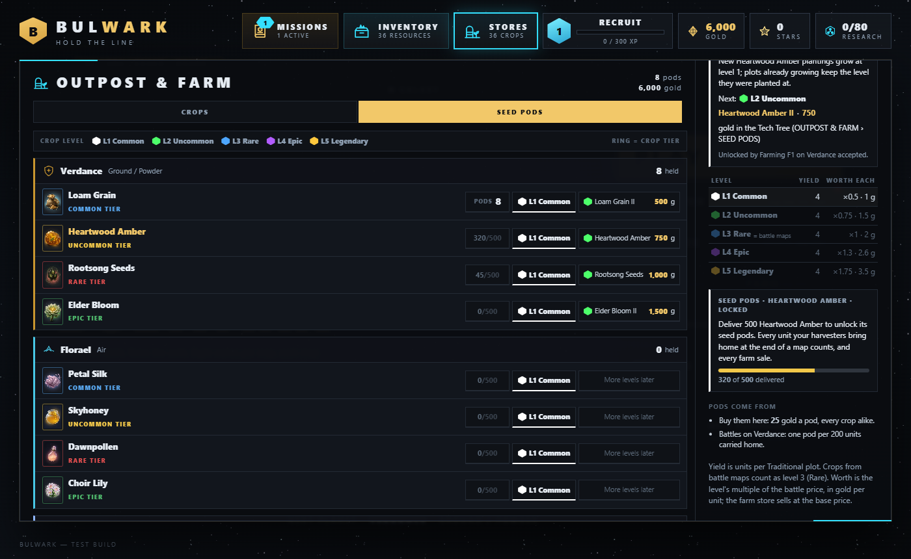
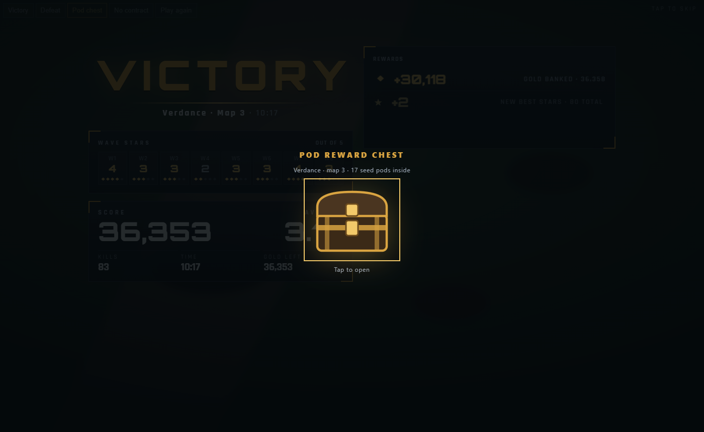
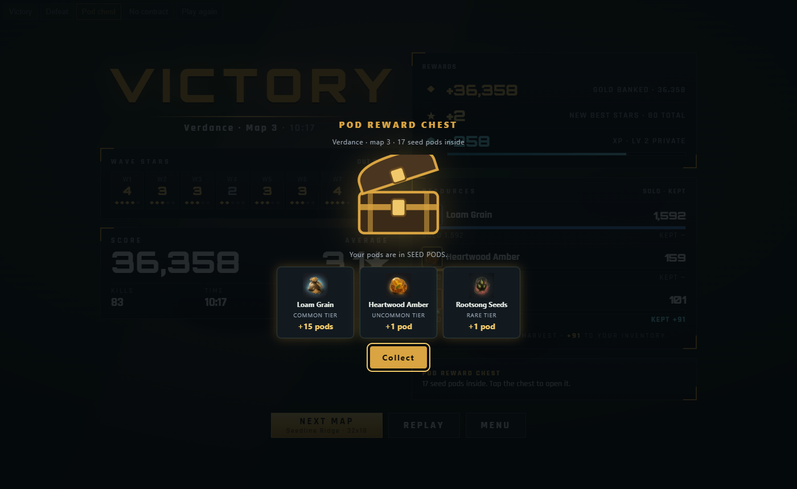
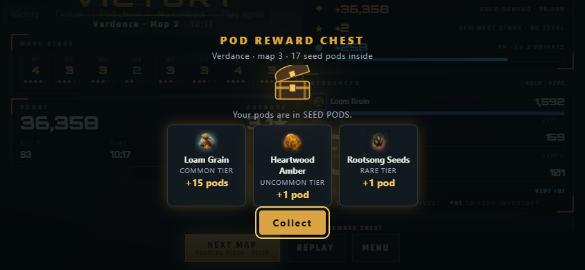
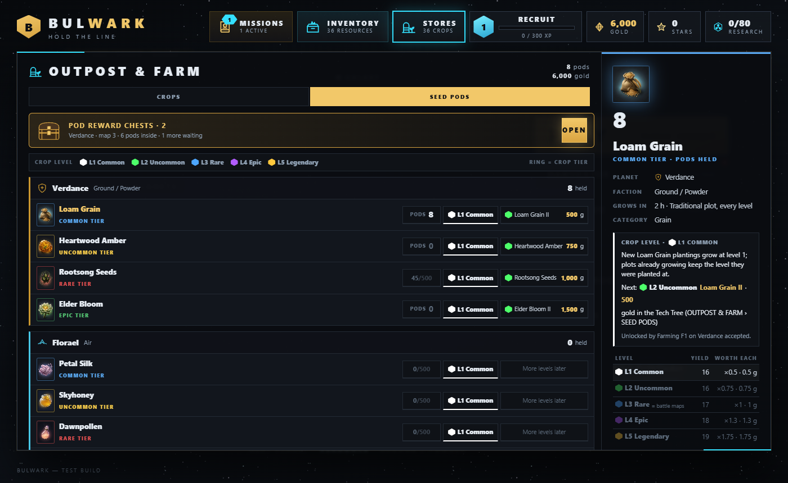

# Farming — design (a new game mode)

Status: draft 3 for owner review · 2026-11-09 · new game mode, design only (no epic, no tech plan yet) · draft 2 applied
the owner's seed pod, growth stage and enhancement rules (17:30); D7 and D12 decided (17:32); the Hydroponics and
Underground views added (§2.4); D16 and D17 decided (17:44); grow rooms at ship-interior scale, the avatar and gro-bots
(§2.6); room machines and irrigation per third of a room (§2.7, 17:51); machine levels and maintenance (§2.8); the
scale rule and its prototype (§4.4, 18:46) [MM-story_mwa3hi6n_1]; scale signed off, the art direction and the first
models (§4.5, 19:45) [MM-story_mwa5fhvz_2]. **Draft 3** (20:41): the underground doorway is an **ammunition bunker**;
the ship's **avatars on the surface farm**; farming **unlocks at Rig Mk II**; **battle quality is pod level 3**; crops
are **the 36 surface resources**; who gives what is the companion design `Farming-Distribution-Design.md`
Repo copy to be: `docs/16 Bulwark MM/design/Farming-Design.md`

## Owner direction (2026-11-09)

> We need a new design for farming around the outpost. This will allow users to harvest crops instead of fighting for
> them, although the quality on a farm will be generally lower until the seed pods are fully upgraded.
>
> The farms will have multiple ways to cultivate a crop, and after farming is fully implemented and a user researches a
> certain tech level they will unlock manufacturing ship parts and upgrades.
>
> **Bulwark Farming** — to create value on outpost and introduce variation that could justify multiple farms.
> 1. Traditional farm plot 2. Irrigated farm plot 3. Terraced farm plot 4. Subterrain farming 5. Mining
> 6. Hydroponic farming 7. Vertical farm structure 8. Spatial farming — crops compete for territory 9. Orchards
> 10. Solo tree farming 11. Tub crops 12. Hydrofarming 13. Truffle hunting 14. Surface collection
>
> Crops need their own atmosphere to grow, but there will be mystery crops that actually grow better under specific
> conditions on another planet (not the one the crop was originally found on). For example a hydroponic growth
> structure with an oxygen scrubber could produce a super crop on another planet.
>
> We will need to introduce: Seedlings (as items; as a new inventory view) · Farm plots (prepped for seeds, seeded,
> growing, ready to harvest, harvested) · Harvested (fruit, vegetable, grain, materials) · Mining (minerals, gems) ·
> Processing (refining, manufacturing).

> Right now we are just making the design document, this is a completely new game mode. *(owner, 2026-11-09)*

> Seed pods are what we collect for growing and seed pods have 5 level upgrades — common, uncommon, rare, epic,
> legendary. When pods grow they have 4 stages: planted, sprout, plant, fruited, dead. When fruited they get harvested
> for full value and the particle effect looks like fire embers floating up with noise in the 5 corresponding colors:
> white, green, blue, purple, gold. Dead plants can be harvested for the cost of the seed pods for replanting.
>
> Legendary pods require some enhanced tech like fertilizer, sprinklers, grow lights of a specific color, hydroponic
> chambers, air tanks to optimize atmosphere, etc. Once the player unlocks hydroponics the tech is available for every
> plant that benefits — not all will. *(owner, 2026-11-09, 17:30)*

> Farming is done on outpost maps. Helium-4. *(owner, 2026-11-09, 17:32)*

> When we introduce underground farming and hydroponics, we will create new views of the farm so all hydroponics look
> the same, and all underground look similar with different accent rocks and crystals. *(owner, 2026-11-09)*

> D16 — yes. D17 — indoor grow rooms are all the same size (full screen) but they can have multiple plots.
> *(owner, 2026-11-09, 17:44)*

> The indoor growing areas will be the same scale as the ship interior with a different perspective. The Avatar can
> walk around and plant or harvest, or gro-bots can be built to handle the chores. *(owner, 2026-11-09)*

> Inside the grow rooms there will be machines — irrigation system, air control, robot bay, etc. These get added over
> time to increase functionality. Since this room will be large a user will need to purchase an irrigation system for
> each 1/3 of the room they want to plant. *(owner, 2026-11-09, 17:51)*

> These machines will need some maintenance, so after a week the level one machine will need maintenance at no cost. A
> user can do maintenance more often if they are online. *(owner, 2026-11-09)*
>
> Level 1 machines go 4 days, level 2 machines go 10, level 3 go 15, level 4 go 20 days. *(owner, 2026-11-09)*

> Can we prototype the visuals. I want the scale correct on the outpost before we start full development. A single
> farm plot of 4 rows should be about the same size as 4 machine guns in a square. *(owner, 2026-11-09, 18:46)*

> Scale is perfect, but we want AAA 3D models. Avoid texture because of memory limits. Ground terrain will look
> identical to current maps. The vertical farm can be 2x2 and the upgrades add levels (1, 2, 3, 4). The hydroponic farm
> should look like a glass dome from the outside, and the underground can look more like a 2x2 mound of dirt with a
> large steel door. *(owner, 2026-11-09, 19:45)*
>
> Model using blender headless, for machines, trees, plants, hydroponics, and vertical farm. Detailed but flat shaded,
> no textures. *(owner, 2026-11-09, 19:48)*

> Make the underground entrance look more like an ammunition storage mound, more sinister. The avatars on the outpost
> farm will look the same as the avatars we use in the Capital ship.
>
> To unlock farming the player will need to level up the miner to level 2.
>
> We need a design for distribution of the seed pods, upgrades to the machinery. The missions and crops will need to be
> distributed across all the factions. The crops for each faction can be the same as the ones that get harvested, with
> the variation of seed pod quality. The quality we gather in the game is level 3. *(owner, 2026-11-09, 20:41)*

The 17:30 direction is applied in §3, §5, §7, §8, §9 and §12. It replaces draft 1's "seedling" item (now the **seed
pod**), its Poor → Prime grades (now the **five pod levels**), its Seed Pod I–III research, its "ripe crops slip a
grade" rule (now the **dead** stage) and its per-building atmosphere module slots (now **enhancements**, unlocked
once, used by every crop that benefits). "4 stages" with five names is read as four growth stages plus the dead end
state (§5.1). The 17:32 answers close D7 (§2.1) and D12 (§9.3): Lumen's uncommon surface resource is renamed
**Helium-4**, so Helium-3 is only Lumen's rare ore. The views direction is §2.4. The 17:44 answers close D16
(Vertical farms and Tubs stay on the surface) and D17 (**grow rooms**: every indoor room is the same full-screen size
and holds several plots, §2.5). Grow rooms are built at the capital ship interior's scale, seen from a different
angle, and worked by the player's **avatar** or by **gro-bots** (§2.6). The 17:51 direction is §2.7: a grow room is
**large**, split into **thirds**, and is equipped over time with **machines**; each third needs its own **irrigation
system** before it can be planted. The maintenance direction is §2.8: machines have **four levels**, each needs **free
maintenance** at an interval set by its level (4, 10, 15, 20 days; the second message replaces the first's "after a
week"), and a player who is online can maintain early. The 18:46 direction sets the **scale** (§4.4): a 4-row farm plot
is **2 × 2 battle cells**, the area of four Machine Guns in a square. The 19:45 direction signs that scale off and sets
the **art** (§4.5): detailed models built in headless Blender, flat shaded, no textures; the outpost map's own ground;
the **Vertical farm is 2 × 2 and its upgrades add floors, levels 1–4**; the **Hydroponic farm's doorway is a glass
dome**. The 20:41 direction makes the **Underground farm's doorway an earth-covered ammunition bunker** (§2.4),
replacing 19:45's plain dirt mound; puts **the capital ship's avatars on the surface farm** too (§2.6); **opens farming
at Rig Mk II**, the outpost's level-2 miner (§2.2); sets **battle quality at pod level 3, Rare** (§8.2); and makes **each
faction's crops its own four surface resources** (§9.3). How pods, machine upgrades, missions and crops are spread
across the nine factions is `Farming-Distribution-Design.md`.

## Owner direction (2026-11-10): earned seed pods

The owner's rules 9–18 (verbatim in `docs/tech-plan/Farming.md`, *Owner rules*) change how pods are earned and levelled.
They override §8 and §9 where those differ, and those sections now say so:

- **Pods have no level** (rule 9). A crop's level is the player's, not the pod's: farms start at level 1, and each plot
  keeps the level it was planted at (§8.3).
- **A crop's pods unlock after 500 of it are delivered** (rule 10, built): access only; the pods still have to be
  acquired (§9.4).
- **The Pod Reward Chest delivers the pods** (rule 11, built): awarded at the end of each map, one pod per 100
  delivered, opened right there with one click (§9.4).
- **Mastery opens levels 2–5** (rule 12); **each level needs machinery** (rule 13): level 3 a fertilizer, level 4
  agrobots, level 5 irrigation, and for some crops a planting method at level 3; one irrigation unit waters 4 connected
  plots and changes their look.
- **Farm visitors, the farming log, off-world pods, seasonal crops and the crop mastery award** (rules 14–18): a
  visitor per faction who roams the outpost; tips in a log; pods from other planets give no fruit at levels 1–2 ("Are
  you sure? I don't think those grow here."); holiday crops; a chest of gold, **gems** (the premium currency; gold is
  the standard one) and a trophy at level 5.

## 1. What farming is

Bulwark has two modes today. **Battle** is played in sessions: land, hold eight waves, take what you can carry.
**Outpost** keeps running while the player is away: mine, store, sell, hold raids. **Farming is the third mode.** It is
the land around the outpost, worked instead of fought over.

| | Battle | Outpost | **Farming** |
|---|---|---|---|
| Verb | defend | extract | **cultivate** |
| Time | one session | always on | always on, on crop clocks |
| Gets you | gold, surface resources (at Rare quality) | ore, gold | crops at the level of the pod planted; more pods; later, parts |
| The decision | where to build towers | what to mine, deep or shallow | **what to grow, how, where, and which pods to spend** |

What the mode gives the player that the others do not:

- **A peaceful route to the surface resources.** The 36 resources the battles fight for (Loam Grain, Skyhoney, Frost
  Pearl…) are the crops. A farm on Common or Uncommon pods yields less than fighting; a Rare pod matches the battle;
  Epic and Legendary pods beat it.
- **Variety that justifies many farms.** Fourteen ways to produce something, each good at a different thing, so a good
  farm is a mix, and the best mix differs per planet. Each faction teaches one of them (Distribution §1).
- **A collection game.** Seed pods in five levels, per crop, per planet: the inventory is a set to complete and level up.
- **A discovery game.** Mystery crops thrive somewhere other than home, under conditions the player has to find.
- **A place to be, and to build up.** The player's own avatar walks the farm and the rows of a large grow room that fills
  up with machines over time, keeps them running, and later hands the rounds to gro-bots.
- **The road to manufacturing.** Crops, ores and gems are the inputs to refining and, at a research level, to ship parts
  and upgrades.

It is not a second tower-defense game and not a twitch game. Its tension comes from planning, clocks and discovery.

## 2. Where it lives and how it opens

### 2.1 The map

**Farming is done on the outpost maps** (owner, 2026-11-09). Each planet's outpost map (64 × 32, Outpost-Design §9) is
shared by the two modes: the outpost owns the mesa and its pads; the farm owns the land around it that the outpost
leaves alone, its slopes, its water cells, its tree groves, everything that is not a raid lane. One map, two modes, so
the player sees their outpost from the farm and the farm from the outpost. There are no separate farm maps. The indoor
grow rooms (§2.4 – §2.8) are views reached from the map, not maps of their own.

**The ground is the map's own** (owner, 19:45): farming adds no ground art of its own. The farm sits on the outpost
map's baked terrain exactly as the battle and outpost views draw it; plots, buildings and doorways stand on it.

New outpost-map layer (authored in the Terrain Forge, like the outpost layer): **farmable cells** tagged by what they
support — flat soil, slope, water, grove, collection field. The tags come from the terrain data the Forge already has
(height level, water, obstruction families), plus a paint pass. The nine outpost maps must leave enough of each kind for
the methods that suit that planet (Hydrofarming water on Rime, slopes for terraces, and so on). At the §4.4 scale a plot
is a pad's size, so the land round a 21 × 19 mesa on a 64 × 32 map has room for dozens of plots.

### 2.2 How farming opens: the miner at level 2

**Farming unlocks when the miner reaches level 2** (owner, 20:41). The miner is the outpost's **Mining Rig**; level 2
is **Rig Mk II**, the 2× miner that the planet's outpost **contract 2** unlocks (Outpost-Design §2.4: "the rare ore;
Rig Mk II"). So the order on a planet is: outpost contract 1 → contract 2 → build or upgrade a rig to Mk II → that
planet's capital ship offers its first farming contract.

- **Per planet** (proposed, Distribution X4): each planet's farming opens with its own outpost's Rig Mk II, as each
  planet's outpost opens with its own ship. The first Mk II anywhere opens the FARM button.
- **The rig stays a rig.** Nothing about mining changes; Mk II is only the gate.

Colonel Vane already asks it in the outpost scene: *"So tell me: how are you at mining? And farming?"* Farming opens
on the answer.

| | Verdance, contract F1: *Bread for the Regiments* (proposed) |
|---|---|
| Offered | aboard the planet's capital ship, once the Verdance outpost has a **Rig Mk II** |
| Granted | the **Farmhouse** (the farm's hub, §6) on its plot at the mesa's foot, and a **Pod Crate**: 12 Common seed pods of Loam Grain (three plots' worth) |
| Step 1 | **Break ground.** Prep three Traditional plots and plant them. |
| Step 2 | **Bring in a harvest.** Harvest one plot at Fruited and deliver 40 units of grain to the ship. |
| Step 3 | **Grow two ways.** Have two different methods growing at once. |
| Pays | 1,500 gold, +15 loyalty with the faction, 300 XP, Sprinklers |
| Unlocks | the FARM button, the SEED PODS inventory tab, Irrigated plots |

Every planet has three farming contracts, F1 *Break ground*, F2 *Our way* and F3 *The prize*, each built on that
faction's own crops, method and machine: the 27 are listed in Distribution §5.

### 2.3 The menu

A **FARM** button beside OUTPOST on the main menu, locked until the first farming contract is accepted ("Upgrade a
Mining Rig to Mk II, then accept a farming contract aboard a capital ship"). Its status line works like OUTPOST's:
*3 plots fruited*, *2 plants dead*, *silo full*, *pods low*, *2 machines need maintenance*. Inside the outpost view, a
tab switches between OUTPOST and FARM on the same map without reloading it.

### 2.4 Three views of the farm

The farm has **three kinds of view** (owner, 2026-11-09). The **Surface** is the outpost map. When the player
introduces hydroponics and underground farming, each gets **its own indoor view** instead of crowding the map.

| View | Opens when | What it is | Looks |
|---|---|---|---|
| **Surface** | the first farming contract | the outpost map: every open-ground method, the gathering methods, **Vertical farms and Tubs** (D16), the farm buildings | the planet: its ground, sky and palette |
| **Hydroponics** | the Hydroponic method is learned (Ochre, Distribution §5) | hydroponic grow rooms: chambers on racks | **the same on every planet** |
| **Underground** | the Subterrain method is learned (Xenthe) | underground grow rooms: beds cut into the rock | **similar on every planet**, with that planet's **accent rocks and crystals** |

**The doorways on the surface.** Each indoor room is entered through a 2 × 2 building on the map:

- **Hydroponic farm: a glass dome** (owner, 19:45). A geodesic glass hemisphere on a steel ring and a white pad, with an
  airlock vestibule at the front and a tank beside it. Through the glass the player sees grow benches lit red, blue and
  violet round a cyan light column, so the dome says what is inside from across the map.
- **Underground farm: an ammunition bunker** (owner, 20:41: "more like an ammunition storage mound, more sinister"). An
  earth-covered magazine: a long turfed barrel-vault berm running back from a flat, weathered concrete headwall held by
  splayed wing walls; a heavy two-leaf steel blast door, rust-streaked and X-braced, stencilled with its bay number, with
  a red and black band across its foot and **a red glow leaking from its seam and sill**; red caged lamps either side; an
  orange explosives placard and a red warning plate; a floodlight on the cap; two lightning masts tied by a wire and
  mushroom vents on the berm; razor wire on posts down both flanks; jersey barriers and a drain grate on the apron. It
  stands on any flat buildable ground. It is the one farm building that looks like it should be guarded, which is the
  point: what grows below is the farm's most valuable.

**Getting in and out.** A view tab beside OUTPOST and FARM (SURFACE · HYDROPONICS · UNDERGROUND) shows the views the
player has opened, each with its own status dot. Tapping a dome or a bunker on the surface sends the avatar to its door
and into the room (§2.6). The red dot on the FARM button counts every view.

**Hydroponics: one look everywhere.** A clean, enclosed grow room: rows of chambers on racks, nutrient lines, air tank
manifolds along the walls. The room is identical on every planet; there is no window to the outside. What makes it read
is the light: **each plot glows in the colour of the Grow Lights its crop uses** (§7.2), so a room growing several
crops is bands of red, blue, violet, white and amber, and a crop's embers rise through its own colour. Because it is
one set, the art is built once and reused nine times.

**Underground: one cavern family, each planet's stone.** Behind the bunker's door, a dark cavern of beds cut into the
rock, lit by grow lamps and by what glows in the walls. The layout, the beds, the props and the lighting rig are one
shared kit. Each planet adds its **accent rocks and crystals**, taken from its own surface resources and palette
(proposed, to be checked against the Faction Terrain Design):

| Planet | Accent rocks and crystals |
|---|---|
| Verdance | roots through loam, amber seams |
| Florael | pale stone, pollen-gold crystal clusters |
| Ochre | sandstone, quartz points, salt crust |
| Kessra | slag and copper veins, rust stains |
| Rime | blue ice walls, frost crystals |
| Cinder | basalt columns, glowing obsidian cracks |
| Lumen | grey regolith, Helium-4 frost crystals, violet lens shards |
| Xenthe | violet rock, glowcap clusters, magenta veins |
| Vexmire | peat walls, green toxic seeps |

So the underground on Rime reads as ice and on Cinder as fire, from one kit plus nine small accent sets.

**What stays the same inside.** The plots in both views follow the same growth stages, the same Fruited and Dead rules,
the same pod levels and the same ember harvest effect (§5). Crops indoors are **never raided** (§10): the doorways are
surface buildings and can be shot like any other, but nothing inside is trampled.

### 2.5 Grow rooms

**Every indoor grow room is the same size: one full screen** (owner, D17), and it is **large** (owner, 17:51): a big
hall at the ship interior's scale, not a closet. A room never scrolls, zooms out or grows; it always fills the view.

- **A doorway is a room.** Each glass dome built on the surface is one hydroponic grow room; each bunker is one
  underground grow room. The first doorway opens the view; each further one adds another room of the same size.
- **A room is three thirds.** The floor is split into **three sections** — left, centre and right thirds — each with
  its own row of **plot slots** (proposed: 4 per third, 12 per room). A third is the unit the player equips and opens
  (§2.7): its plot slots can only be planted once that third has its **irrigation system**.
- **Along the walls, machine slots.** Fixed places for the room's machines (§2.7). The room starts bare and fills up as
  the player adds them, so a mature room looks visibly different from a new one.
- **Plots are the unit of growing.** Each plot is planted with one crop at one level and runs its own growth stages,
  so one room can grow many crops side by side, each with its own grow-light colour and its own timer.
- **More rooms, more plots.** A player who wants more indoor space builds another doorway, within the buildable ground
  and power they have. The view shows one room at a time; arrows or a strip of room tabs (*Room 1, Room 2…*) move
  between them, each with its own status dot.
- **Room size is the one fixed thing.** Every room of a kind has the same three thirds, the same plot slots and the
  same machine slots, so the indoor art is one set, the layout is one layout, and a room can be laid out once for every
  screen.

### 2.6 The avatars: on the surface and in the grow rooms

**The avatars are the capital ship's** (owner, 20:41: "the avatars on the outpost farm will look the same as the
avatars we use in the Capital ship"). One figure everywhere: the ship's crew rig (`src/ship-interior/crew.js`,
Ship-Crew-Characters §3), its helmets, outfits and pose machine. The player is the **gold hard-hat figure**
(`PLAYER_CFG`); the farm's other people are that faction's crew in their faction look (`cfgFor(faction)`: Verdance's
olive outfit and combat helmet, Rime's diver's helmet, and so on).

**On the surface farm.** The avatar is on the outpost map too, at the outpost scale.

- **Size** (proposed): **0.45 of a battle cell tall** (about 1.8 units of the 4 to a cell), so a 2 × 2 plot is about four
  and a half people across. The rig is the same; only its scale changes. The scale prototype shows it beside the plots,
  the Machine Guns and the bunker.
- **Tap a plot, the avatar goes.** On the surface, as indoors, tapping a plot sends the gold avatar walking to the plot's
  front edge; it works the plot (the `work` pose: a kneel-and-tend) and the plot moves on: prep, plant, harvest. Taps
  queue; the avatar works them in order. HARVEST ALL queues every Fruited and Dead surface plot for the avatar.
- **Farmhands** (proposed): each planet's farm has two or three of that faction's crew walking the rows, stopping to
  work, point and talk, as the ship's deck crew do (Ship-Crew-Characters C6). They are life, not labour: they never
  change a plot. They make a planet's farm read as that faction's.
- **Doorways.** The avatar walks to a dome's airlock or the bunker's blast door and through it when the player enters a
  room, and back out when they leave.

**Inside a grow room: same scale as the ship interior, a different angle** (owner). A grow room is built in the capital
ship interior's units and with its people: the same figure size, the same room proportions, the same primitive-room
approach and the same orthographic world (Capital-Ship-Interior §3.3, §3.5: a 100 × 56.25 stage). A person standing at
a hydroponic rack is the same height as a crewman at the bar of *The Long Ledger*, so the two interiors read as one
world. A grow room is much bigger than one ship room: it is a hall that fills the screen. (Indoors the figure is the
yardstick, and the machines are modelled in metres against a 1.8 m avatar, §4.5.)

What changes is the **angle**. The ship is a side cutaway: the player looks at a wall of rooms, and figures walk along
deck lines. A grow room is one room seen **from above at three-quarters**, looking down into it, so the plots on the
floor read as rows, the machines stand against the walls, and the avatar walks among them, not only along a line.
Proposed: the same orthographic camera tilted to about 50° looking down, one fixed framing that fills the screen
(§2.5). Phone portrait fits the room's width and keeps all three thirds on screen.

**The avatar works the room** (owner):

- **Tap a plot, the avatar goes.** Tapping a plot sends the avatar to stand at it; the action happens on arrival, with
  a short animation: **prep** (a kneel and a sweep), **plant** (a kneel, pods pressed in), **harvest** (a pick or a
  cut, then the embers, §5.3). The plot's panel offers the action that fits its state.
- **Tap a machine, the avatar goes.** Tapping a machine walks the avatar to it and opens its panel: state, level,
  **days to maintenance** (§2.8), MAINTAIN, UPGRADE.
- **Taps queue.** Tapping several plots or machines in a row queues them; the avatar works them in order, and a small
  number over each shows its place in the queue. A second tap on a queued one removes it.
- **The walk is short.** At this scale the far side of a room is a few seconds' walk. The avatar walks; it does not
  teleport, because walking the rows is part of the room's feel.

**Gro-bots do the chores** (owner). A **gro-bot** is a small worker robot that does the rounds the avatar would. Gro-bots
live in the room's **Robot Bay** (a machine, §2.7) and walk the rows on the same paths. It is a small tracked robot,
0.9 m tall, with a basket, two arms and a lit visor (§4.5).

| Bot | Does | Proposed cost | Power |
|---|---|---|---|
| **Gro-bot I** | harvests every **Fruited** plot in its room as soon as it fruits; harvests **Dead** plots (taking the pods back) | 2,500 | 1 |
| **Gro-bot II** | also **preps** harvested plots and **replants** each plot with the same crop at the same level, from the player's pod stock, while stock lasts | upgrade, 5,000 | 1 |

- **A bot never decides for the player.** It never sells, never upgrades pods, never chooses a new crop and never plants
  a pod the plot did not already hold. A plot whose pods ran out is left prepped and flagged *needs pods*.
- **Bots do not maintain machines.** Maintenance is the avatar's job (§2.8), so even a fully automated room asks the
  player in now and then. *(See §14 D31.)*
- **The avatar and the bots share the room.** Any of them can do any growing chore; the avatar's queued taps go first,
  and a bot skips a plot the avatar or another bot is heading to.
- **While the player is away** the bots' work is counted when the game next opens, like the outpost's mining and raids:
  each plot a bot would have reached at its walk speed is harvested at that moment, so a room with enough bots never
  lets a plant die. The yield is banked to the Silo; the embers play only while the player watches. The Robot Bay is a
  machine: if it falls overdue for maintenance, its bots stop (§2.8).
- **How many.** A Robot Bay holds one bot; a higher-level Robot Bay holds a second (§2.7). Bots work only their own
  room; the surface is worked by the avatar.
- **Unlocked** by the FARMING research node *Gro-bots* (§12), Gro-bot II by Kessra's F3 (Distribution §5).

This is the one place farming lets the player hand over the harvest. It is earned (research, gold, power, a Robot Bay)
and limited to the indoor rooms, so the surface stays a reason to come back and the rooms become the player's
well-run, automated part of the farm.

### 2.7 Room machines

**A grow room is equipped with machines, added over time** (owner, 17:51). Each machine is bought from the left-side
icon list while the player is in the room, installed in a machine slot along the walls, and draws power through the
room's doorway. A new room is a bare hall with nothing but its door; a mature room is lined with machines.

**Irrigation is per third** (owner): *a user will need to purchase an irrigation system for each 1/3 of the room they
want to plant.* An empty third's plot slots are greyed with "needs irrigation"; buying that third's Irrigation System
opens its slots for plots. A player can grow in one third of a new room, then open the other two as gold allows.

| Machine | Where | What it does | Proposed cost (level 1) | Power | Specialist faction (Distribution §6) |
|---|---|---|---|---|---|
| **Irrigation System** | one per third (3 per room) | **required to plant that third**; waters its plots. In a hydroponic room it is the nutrient loop and pumps; underground, drip lines and a cistern | 600 each | 1 each | Rime |
| **Air Control** | one per room | delivers the **Air Tanks** a crop needs (oxygen, scrubbed, pressurised) to every plot in the room | 2,000 | 2 | Florael |
| **Light Rig** | one per third | delivers **Grow Lights** to that third's plots, each plot in the colour its crop wants | 1,200 each | 1 each | Ochre |
| **Climate Unit** | one per room | delivers **Climate Control** (heater, chiller) to the room | 1,800 | 2 | Cinder |
| **Nutrient Doser** | one per room | delivers **Fertilizer** to the room's plots | 1,000 | 1 | Vexmire |
| **Robot Bay** | one per room | houses **gro-bots**: one bot, two from level 3 | 3,000 | 1 | Kessra |

The list is the owner's three (irrigation system, air control, robot bay) plus the machines that carry the other
enclosed enhancements, so each enhancement has the piece of equipment that brings it into a room. "Etc." leaves room for
more (a Pod Rack that holds a room's replanting stock, a Hydroponic Chamber upgrade to the irrigation in a hydroponic
room); they are added the same way.

**Research unlocks, machines deliver.** The owner's earlier rule holds: once an enhancement is researched it is
available to **every plant that benefits**, on every farm (§7.2). In a grow room that availability arrives through the
room's machine: a room with Air Control gives Air Tanks to every crop in it that benefits, with no per-plot fitting. A
room without one does not, so equipping a room is how the player decides which rooms get the expensive tech. *(See §14
D26.)*

**Machines show their work.** Water runs in the irrigation lines of an open third; the Air Control's fans turn and its
tank gauges glow; a Light Rig throws each plot's colour; the Robot Bay's charging ring glows while a bot is home. A
machine without power, or overdue for maintenance (§2.8), stops and shows a warning icon (Outpost §4.5).

### 2.8 Machine levels and maintenance

**Every machine has four levels** (owner), and **every machine needs maintenance**, which is **free** (owner). How long
a machine runs between maintenance is set by its level:

| Machine level | Runs between maintenance (owner) | Upgrade cost (proposed, × level-1 cost) | Unlocked by (Distribution §6.1) |
|---|---|---|---|
| **Level 1** | **4 days** | — (as bought) | the machine's research node |
| **Level 2** | **10 days** | 1.5× | Machine Engineering I |
| **Level 3** | **15 days** | 3× | Machine Engineering II + the specialist faction's F2 blueprint |
| **Level 4** | **20 days** | 6× | Machine Engineering III + the specialist faction's F3 blueprint |

**How maintenance works:**

- **The clock.** Each machine counts down from its interval from the moment it is installed, and from each maintenance.
  The machine's panel and a small gauge on the machine show the days left; the gauge turns amber in the last day.
- **Maintaining.** MAINTAIN on the machine's panel sends the avatar to it; it opens a hatch, works a few seconds (a
  wrench, sparks, a hiss of steam), closes it. It costs nothing and resets the clock to the full interval.
- **Early is allowed** (owner): *a user can do maintenance more often if they are online.* A player in the game can
  maintain any machine at any time, however many days it has left; it always resets to the full interval. A player who
  checks in every few days can keep a level-1 room running for good.
- **MAINTAIN ROOM** on the room's header queues every machine in the room for the avatar, so a full room is one tap
  and a short walk.
- **Only the player maintains.** Maintenance needs the player in the game, through the avatar. Gro-bots do not do it
  and nothing does it while the player is away. *(See §14 D31.)*
- **Overdue** (proposed): a machine whose clock reaches zero **stops**, exactly like a machine without power (Outpost
  §4.5, "no electricity, no operation"): an Irrigation System's third stops watering and its plants pause where they
  are; Air Control, a Light Rig, the Climate Unit or the Nutrient Doser stop delivering their enhancement, so the room's
  crops grow without it (an affected Legendary pod grows as Epic, §7.3); a Robot Bay's bots stop working. Nothing is
  destroyed and nothing is lost; one MAINTAIN starts it again. The FARM button's status line and the room tab show
  *needs maintenance*. *(See §14 D30.)*

**Why levels matter.** A level-1 room asks the player in every 4 days; a level-4 room every 20. Upgrading a machine is
the main way to make a room need the player less, alongside gro-bots, and upgrading the Robot Bay to level 3 gives it
its second bot (§2.7). Proposed: a machine's level raises **only** its interval and, for the Robot Bay, its bot count;
its effect on the crops stays the same at every level. *(See §14 D32.)* Because levels 3 and 4 come from each machine's
specialist faction, a room of level-4 machines is a room built with six factions' help.

**Why it is free.** The owner's rule makes maintenance a reason to visit, not a cost. It is the one chore automation
never removes, timed loosely enough (days, not hours) that a player who comes back on their own schedule rarely sees a
machine stop.

## 3. The core loop

```
 collect seed pods ──► prep a plot ──► plant ──► sprout ──► plant ──► FRUITED ──► harvest: full value ──► silo
       ▲                                                                 │                             │
       │                                                       not harvested in time                    ├──► sell
       │                                                                 ▼                              ├──► contracts
       │                                                               DEAD ──► harvest: pods back ─┐   └──► refine → manufacture
       │                                                                                            │
       └──── battles (Rare pods), faction ships, the Collective, truffle hunts, pod upgrades, returned pods ◄───┘
```

**Who does the work.** On the surface and indoors, the player's avatar walks to each tapped plot and works it; indoors
a gro-bot can do it on its own (§2.6). Selling is **always a manual tap** (Outpost Q5). The reason to come back is that
something has fruited, before it dies, and that is true everywhere a bot does not work.

A second, slower loop runs over it indoors: **equip and keep the room**. Open a third, add a light rig, add air control,
add a robot bay, raise each machine's level; and come back every few days to maintain them (§2.8). A third loop runs
across the galaxy: **farm with the factions**, whose contracts teach the methods, whose blueprints raise the machines and
whose battles and ships supply the pods (Distribution).

## 4. The fourteen methods

### 4.1 The families

The fourteen split into three families. The family decides which enhancements can reach the crop (§7.2): only enclosed
methods can change the air or the light.

| Family | Methods | Air and light |
|---|---|---|
| **Open ground** — grows in the planet's own air | Traditional, Irrigated, Terraced, Spatial, Orchard, Solo Tree, Hydrofarming | the planet's, fixed |
| **Enclosed** — grows in a controlled environment | Hydroponic and Subterrain (indoor grow rooms, through their machines); Vertical Farm and Tub (on the surface) | changed by air tanks and grow lights, so off-world and mystery crops can grow here |
| **Gathering** — nothing is planted | Surface Collection, Mining, Truffle Hunting | — |

### 4.2 What each one is for

Every method has to win at something, or nobody builds it. The "best at" column is the reason to build it. Footprints
are in battle cells at the §4.4 scale; the Traditional plot, the Vertical farm, the glass dome and the bunker are the
owner's, the others are proposed to match. The teaching faction is Distribution §1.

| # | Method | Footprint (cells) | Where it can go | Best at | Pays for it with | Taught by |
|---|---|---|---|---|---|---|
| 1 | **Traditional plot** | **2 × 2, 4 rows** (owner) | flat soil | cheapest; no power | slowest growth; native crops only | every F1 |
| 2 | **Irrigated plot** | 2 × 2, 4 rows, with a channel on one edge | flat soil within 4 cells of water or a Pump | 1.5× growth speed | needs water reach; Pump draws power | the first F1 |
| 3 | **Terraced plot** | 2 × 3: three steps, one cell deep each | slope cells (unbuildable for anything else) | uses land nothing else can; highland crops grow 1.25× | a long prep (twice a plot's) | Kessra |
| 4 | **Subterrain farm** | **a 2 × 2 ammunition bunker** (owner) = **one underground grow room** (§2.5) | flat buildable ground | **raid-proof**; stable temperature; can be automated (§2.6) | dark: only low-light crops; machines to buy and maintain (§2.7, §2.8) | Xenthe |
| 5 | **Mining** | the Mining Rig's 2 × 2 pad | ore deposits | ore (minerals) and **gems** (§9) | as Outpost-Design §4 | the outpost |
| 6 | **Hydroponic farm** | **a 2 × 2 glass dome** (owner) = **one hydroponic grow room** (§2.5) | anywhere buildable | fastest growth (2×); enclosed; raid-proof inside; can be automated (§2.6) | power; machines to buy and maintain (§2.7, §2.8) | Ochre |
| 7 | **Vertical farm** | **2 × 2; upgrades add floors, levels 1–4** (owner) | anywhere buildable, **on the surface** (D16) | most yield per surface cell, up to four floors; enclosed | power per floor; expensive | Lumen |
| 8 | **Spatial farm** | 4 × 4 field, half-cell patches | flat soil | the only method where yield can exceed the pods planted many times over (§5.5) | the player shares it with what they plant | Florael |
| 9 | **Orchard** | 3 × 3, four trees | flat soil or grove | **perennial**: fruits again without replanting | a long first growth (24 h) | Verdance |
| 10 | **Solo** (tree or spire) | 2 × 2, one large growth in a stone ring | anywhere open, one per 8 cells | one **premium** item (epic-tier crops); boosts plots next to it | a very long grow (48 h) | Cinder |
| 11 | **Tub crop** | 1 × 1 | anywhere **on the surface** (D16), **including the mesa rim and spare pads** | **movable**; enclosed | small yield | Vexmire |
| 12 | **Hydrofarm** | 2 × 2 of water | water cells | the only farm on water | water planets only (Rime most) | Rime |
| 13 | **Truffle hunting** | a hunter drone's zone | around groves, fungal ground, vents, nests | **mystery pods** and buried rares, by chance (§9.3) | random; nothing guaranteed | Xenthe |
| 14 | **Surface collection** | the Resource Bay's harvesters | surface resource fields | the battle's resources with no planting, at Rare quality | slow regrowth (5 % of battle, Outpost §6.2) | the outpost |

**The Vertical farm's levels** (owner): a level-1 Vertical farm is one glass floor of grow trays on a plinth; each
upgrade adds a floor, up to four. The roof (fans, water tank, beacon) rides on top of the highest floor, and a green pip
by the door lights for each floor. Proposed: each floor is a 2 × 2 plot's worth of growing (4 pods, a plot's yield), so
a level-4 Vertical farm grows four plots' worth on four cells; each floor draws 1.5 power; the upgrades cost 1×, 1.5×,
2× the farm's price; floors 3 and 4 come from Lumen's F2. *(See §14 D37.)*

An indoor plot (a chamber or a bed) has the same 4 rows and takes the same 4 pods (proposed). Each is one plot with its
own crop, level and stages.

Surface Collection and Mining already exist in the Outpost (the Resource Bay and the Mining Rig). Farming adopts them as
methods, so their output shows in the farm's ledger and counts toward farming research. Nothing about how they work
changes. The growth stages and pod levels (§5, §8) apply to the planted methods only.

### 4.3 Unlock order

| Stage | Methods | Unlocked by |
|---|---|---|
| Start | Traditional, Surface Collection, Mining (already owned through the outpost) | the first F1 (after Rig Mk II) |
| Early | Irrigated | the first F1's reward |
| By faction | Orchard, Spatial, Hydroponic, Terraced, Hydrofarming, Solo, Vertical, Subterrain and Truffle Hunting, Tub | each faction's **F2** teaches its specialty method (Distribution §5); once learned it works on every farmed planet, with its research node bought as usual |

Not every method is useful on every planet. Hydrofarming needs water; Terraced needs slopes; Lumen has no open-ground
farming at all (no air). That is intended: a player's farms look different on every planet, and learning every method
takes contracts with every faction.

### 4.4 Scale on the outpost map

**The yardstick** (owner, 18:46; **signed off**, 19:45: "scale is perfect"): *a single farm plot of 4 rows should be
about the same size as 4 machine guns in a square.* Every defense takes one battle cell, so four Machine Guns in a
square cover **2 × 2 cells**, and that is a Traditional plot.

| | Cells | Model units (4 to a cell) |
|---|---|---|
| Machine Gun, Cannon, Wall segment | 1 × 1 | 4 × 4 |
| **Farm plot, 4 rows** | **2 × 2** | **8 × 8** |
| One row | 0.5 × 2 (a ridge about 0.3 wide, a furrow between) | 2 × 8 |
| Outpost pad (Power Station, Storage Tower, Mining Rig, bays) | 2 × 2 | 8 × 8 |
| Glass dome, bunker, Vertical farm, Solo tree | 2 × 2 | 8 × 8 |
| Outpost Hub pad | 3 × 3 | 12 × 12 |
| **Avatar** (proposed) | 0.45 tall | 1.8 tall |

So a plot is exactly an outpost pad's size (the pads are at the half-scale sizes, `task_mw8ilg1n_9`). That keeps the
surface on one grid: plots, pads and defense cells line up, and a farm next to the mesa reads as part of the same base.
Rows run north–south, along the battle camera's view, so each of the four reads at the battle angle. A plot carries 4
plants per row (16 in all) as art; the plant count is decoration, the pods are per row (§8.1).

**The scale prototype** [MM-story_mwa3hi6n_1] is a standalone page on Verdance outpost ground, reviewable in a browser
outside Claude: the half-scale outpost pads and four Machine Guns on the mesa; one plot in each state, which the gold
avatar walks to and works when tapped, with the ember harvest in the chosen pod level's colour; Verdance farmhands on
their rounds; four real Machine Guns beside a plot and four Machine Gun ghosts on another; every surface method and both
doorways at their footprints, a crewman beside the bunker; the battle camera (37°, facing north), a top-down
orthographic scale check and free orbit. It draws the Blender models of §4.5 and the ship's crew rig. Repo home:
`prototype/test-game/tools/farming/scale.html`.

### 4.5 Art: the models

**The art direction** (owner, 19:45 and 19:48):

- **Detailed models, flat shaded, no textures.** Memory is the constraint. Every surface is a material with a flat
  colour; detail comes from geometry (chamfers, ribs, rivets, struts, fins, layered leaves), never from an image. No
  texture is loaded for any farm model.
- **Built in headless Blender**, the same way as the outpost buildings and capital ships (Outpost tech plan §6.2):
  one Python script per family of models, run with `blender -b -P`, exporting GLB. Several agents can run it at once.
  It covers the machines, trees, plants, the hydroponic dome, the vertical farm and the bunker.
- **The ground is the map's.** No farm ground art (§2.1). In the prototype the ground is a stand-in.
- **People are the ship's crew rig**, not Blender models (§2.6).

**The material contract** (shared with the outpost models, so the game's existing loaders and bloom apply):

| Material | Use |
|---|---|
| `trim` | the faction colour slot (Verdance orange by default), recoloured at load as the outpost buildings are |
| `glow_*` | emissive parts (grow lights, lamps, beacons, gauges, the bunker's door seam, the bloom on a solo tree); picked up by bloom and `isGlowKey` |
| `pod`, `glow_pod` | the seed pod and its ring; tinted at load to the pod level's colour (§5.3) |
| `glass` | the dome, the vertical farm's curtain walls, canisters: transparent, no depth write |
| everything else | flat colours: hull, steel, concrete (light and weathered dark), rust, soil, turf, bark, leaf, straw, grain, hazard yellow, black and red, signage white, placard orange |

**The models** (story [MM-story_mwa5fhvz_2]; scripts `tools/blender/farming/build_farm_models.py` and
`farm_common.py`; output one GLB per family):

| GLB | Nodes | Scale | Triangles (all nodes) | Notes |
|---|---|---|---|---|
| `plant_grain` | `grain_planted`, `_sprout`, `_plant`, `_fruited`, `_dead`, `_harvested` | battle units | 2.8k | one plant per node: a pod in a soil mound with its glowing ring; shoots; green stalks with leaves; straw stalks with grain heads and awns; fallen grey stalks; stubble and straw. Drawn instanced, 16 to a plot |
| `plant_leafy` | `leafy_*` (the same six states) | battle units | 0.5k | a rosette crop: pod, two seed leaves, a full rosette, the rosette over a violet bulb, wilted, a hole and scraps |
| `tree_orchard` | `tree_orchard` | battle units | 0.9k | leaning trunk with a root flare, five branches, clustered canopy, red fruit on stems |
| `tree_solo` | `tree_solo` | battle units | 2.6k | a large tree in a ring of stones on a soil bed, glowing white-gold blooms (Elder Bloom) |
| `hydro_dome` | `hydro_dome` | battle units | 2.5k | geodesic glass dome on a steel ring and pad, airlock, tank; inside, three benches under red, blue and violet grow lights round a cyan light column |
| `vertical_farm` | `base`, `floor_1` … `floor_4`, `roof`, `fan_1`, `fan_2` | battle units | 6.2k | each floor: slab and trim, steel columns, glass curtain walls with mullions, two grow trays of crops under magenta grow lights, a level pip; roof: parapet, two turning fans, water tank, antenna beacon. Level *n* shows floors 1–*n* and lifts the roof by *n* × 2.6 units |
| `bunker_mound` | `bunker_mound` | battle units | 6.4k | the ammunition bunker of §2.4: barrel-vault berm in dead and dark turf, weathered headwall and wing walls with soot streaks, X-braced blast door with hinges, rust runs, locking bar, stencilled "07" and a red and black band, `glow_redhot` seam and sill, red caged lamps, explosives placard, warning plates, floodlight, lightning masts and wire, vents, razor wire on posts, jersey barriers, grate, rubble |
| `machines` | `irrigation_system`, `air_control` (`fan_1`, `fan_2`), `light_rig`, `climate_unit`, `nutrient_doser`, `robot_bay`, `gro_bot` | metres (avatar 1.8 m) | 5.0k | §2.7's machines and the gro-bot (§2.6) |

Each node's meshes are joined by material in Blender, so a model costs about one draw call per material. The plant
models are drawn instanced: a plot of 16 plants is a handful of draw calls. The animated nodes (`fan_*`) turn in code.

**Still to model:** the plot bed (its frame, soil and ridges are drawn in code in the prototype), the Irrigated
channel, the Terraced steps, the Spatial field, the Tub, the Hydrofarm, the Pump, the Farmhouse, the Silo, the Hunter
Kennel, the Refinery and the Fabricator; the **crop models for all 36 crops** in their stages, living and accreted
(Distribution §2.1); LODs for every model; machine level trims (§2.8); the two grow-room interiors and the nine
underground accent sets (§2.4).

## 5. Plots and growth

### 5.1 The plot and the plant

Two things have states: the **plot** (the ground, chamber or bed) and the **plant** on it (the pods growing there). The
owner's two lists fit together as one track:

| # | State | Belongs to | What the player sees | Moves on when |
|---|---|---|---|---|
| — | **Prepped** | plot | four dark tilled ridges, empty | PLANT with seed pods |
| 1 | **Planted** | plant | pods pressed into the rows, glowing in the pod's level colour | automatic, 10 % of grow time |
| 2 | **Sprout** | plant | small green shoots (accreted crops: first crystals) | automatic, 30 % of grow time |
| 3 | **Plant** | plant | full-size, leafy, no fruit (accreted: a growing cluster); a ring timer over the plot | automatic, end of grow time |
| 4 | **Fruited** | plant | fruit, grain heads, blooms or a ripe cluster in the crop's colour; embers rising (§5.3); red dot on FARM | HARVEST: **full value** |
| — | **Dead** | plant | grey, wilted, fallen (accreted: crumbled) | HARVEST: **the pods back** (§5.2) |
| — | **Harvested** | plot | stubble, flattened rows | PREP (gold and time) → Prepped |

Every plot carries a glowing inlay in its pod level's colour along its front beam, so a field reads by level at a
glance. PLANT, HARVEST and PREP are done by the avatar walking to the tapped plot, on the surface and indoors, or by a
gro-bot indoors (§2.6). An indoor plot can only be built and planted in a third that has its Irrigation System (§2.7);
if that irrigation loses power or falls overdue for maintenance (§2.8), its plants pause where they are, Fruited window
included.

Rules:

- **Prep** costs a little gold and takes a short time (Traditional 100 gold, 2 min; Terraced twice that). A plot can be
  prepped in advance. Chambers and beds prep the same way (flush the chamber, turn the bed).
- **Fruited lasts as long as the crop took to grow** (proposed): a 2-hour grain stays fruited for 2 hours, then dies.
  The window gives the player a real reason to check in, the FarmVille wither rule with a softer floor.
- **Perennials** (Orchard, Solo) go back to Plant after a harvest and fruit again without replanting. If a perennial
  dies, its harvest returns the pods and the tree must be replanted.
- **HARVEST ALL** on the Farmhouse panel queues every Fruited and Dead surface plot for the avatar. Indoor plots are
  harvested by the avatar or a gro-bot, in the room (§2.6).

### 5.2 Dead plants give the pods back

The owner's rule: *dead plants can be harvested for the cost of the seed pods for replanting.* A dead plot's harvest
returns **the same pods, same crop, same level, same count** that were planted (4 for a plot), and no crop. The player
loses the time and the prep, never the pods. So a missed harvest costs a cycle, and a Legendary pod is never lost to a
missed check-in.

### 5.3 The harvest effect

Harvesting a Fruited plot plays the pop-and-count of an ore sale (Outpost §4.3) over a burst of **embers**: glowing
particles that float up off the plot like sparks from a fire, drifting on value noise (the same seeded noise as the
landing craft's thruster wash, Landing-Craft §3.4) so each rises on its own wobbling path, and fade at the top. Their
colour is the pod's level:

| Level | Colour |
|---|---|
| Common | white |
| Uncommon | green |
| Rare | blue |
| Epic | purple |
| Legendary | gold |

A higher level throws more embers, higher, for longer (proposed: count and lifetime ×1.5 per level), so a Legendary
harvest is unmistakable from across the map. A Fruited plot also lets a few embers drift up while it waits, so ripe
plots can be spotted before the player taps. A dead plot's harvest plays no embers: a puff of dry dust, and the pods
fly back to the Farmhouse. The embers rise around the avatar or the bot doing the harvest. The scale prototype (§4.4)
plays both, with bloom.

### 5.4 Grow times (proposed defaults)

Real time, running while away, sized so a player checking in morning and evening always has something to do.

| Category | Grow time (Traditional) | Yield per plot (2 × 2, 4 rows) | Fruited window |
|---|---|---|---|
| Grain | 2 h | 16 units | 2 h |
| Vegetable | 3 h | 12 units | 3 h |
| Fruit | 6 h (Orchard: 24 h first, then 6 h) | 8 units | 6 h |
| Materials, Minerals | 4 h | 6 units | 4 h |
| Gems | 8 h | 3 units | 8 h |

A crop's resource tier stretches its time (proposed: uncommon-tier ×1.5, rare-tier ×2.5, epic-tier ×4) and shrinks its
yield the same way, so an epic-tier crop is a slow, small, valuable harvest. Method speed and yield multipliers in §4.2
apply on top. An indoor plot yields like a surface plot of its crop before those multipliers (proposed). Contract F1's
40 grain is three plots' harvest.

### 5.5 Spatial farming: crops compete for territory

A Spatial farm is a 4 × 4 field the player plants at a few points with several crops. It is cut into half-cell patches
(8 × 8). Every growth tick each crop tries to spread to a neighbouring patch. Who wins a contested patch depends on the
crops' **vigour** (data per crop), how well each suits the planet, and **pod level** (a higher pod is more vigorous). At
harvest, yield is the patches each crop holds.

The player shapes it: where they plant, which crops they mix, and **THIN**, a tap that clears a crop from one patch
(the avatar walks over and pulls it). Some crops are **companions** (raise a neighbour's vigour), some are **invasive**
(fast, cheap). It is the farm's one spatial puzzle, and the reason a player would plant a cheap invasive crop on
purpose: to fence out another.

## 6. Farm buildings

Built from the same left-side icon list as the outpost (Outpost-Design §6, owner 2026-11-07), on farmable cells.
Footprints follow §4.4: a farm building is a pad's 2 × 2 unless noted.

| Building | Does | Power |
|---|---|---|
| **Farmhouse** | the farm's hub; granted by F1; HARVEST ALL for the surface; the **pod bench** where pods are upgraded (§8.3) | 1 |
| **Silo** | stores harvested goods; 8 hours of the farm's output per tier; raids can breach it (§10) | 1 |
| **Pump** (1 × 1) | gives water reach (4 cells) where there is no natural water, for Irrigated plots | 2 |
| **Glass dome** | the surface doorway to one hydroponic grow room (§2.4, §2.5) | 2 (its machines draw on top) |
| **Ammunition bunker** | the surface doorway to one underground grow room (§2.4, §2.5) | 1 (its machines draw on top) |
| **Hunter Kennel** | houses truffle-hunting drones (1, up to 3) | 1 |
| **Refinery**, **Fabricator** | processing (§11) | 4, 6 |

Inside a room, from the same icon list: the room's **machines** (§2.7, each with its levels and maintenance, §2.8) and a
plot per open slot (a chamber or a bed, proposed 300 gold each). On the surface, enhancements (§7.2) are not buildings:
once researched they apply to every plot whose crop benefits. Indoors they arrive through the room's machines. Surface
buildings need no maintenance; the rule is the grow rooms' (§14 D33).

The farm shares the outpost's power grid and its reach rule (Outpost §4.5): a farm far from the mesa needs its own
Power Station. A grow room draws through its doorway: the doorway's own draw plus every machine inside. A doorway
without power stops everything in its room; a single machine that cannot be powered stops alone and shows the warning.

## 7. Atmosphere, environment and enhancements

### 7.1 Every crop needs its own air

Each crop has a **native environment** on four axes; each planet has an **ambient environment** on the same four. A
crop's native environment is its home planet's ambient (it is that planet's surface resource), except where the crop
table in Distribution §2.2 notes a need of its own (a chiller, a heater, a light colour).

| Axis | Values |
|---|---|
| Air | breathable · oxygen-rich · thin · toxic · none |
| Temperature | frozen · cold · temperate · hot · scorching |
| Water | dry · moist · wet · submerged |
| Light | dark · dim · normal · bright |

Proposed planet ambients (to be checked against the Faction Terrain Design):

| Planet | Air | Temperature | Water | Light |
|---|---|---|---|---|
| Verdance | breathable | temperate | moist | normal |
| Florael | oxygen-rich | temperate | moist | bright |
| Ochre | thin | hot | dry | bright |
| Kessra | toxic (smog) | hot | dry | dim |
| Rime | breathable | cold | wet | normal |
| Cinder | toxic (sulfur) | scorching | dry | bright |
| Lumen | none | frozen | dry | bright |
| Xenthe | thin | cold | moist | dark |
| Vexmire | toxic | temperate | wet | dim |

**Match** is how many axes agree between the crop and where it grows. Open-ground methods use the planet's ambient,
so they grow native crops and whatever else happens to suit the planet. An underground room starts from the planet's
Air but is always dark and temperate, with its Water set by its irrigation (moist); a hydroponic room starts from the
planet's Air only, with its water in solution (wet) and its temperature temperate.

| Match | Growth |
|---|---|
| 4 / 4 | 100 % speed |
| 3 / 4 | 70 % speed |
| 2 / 4 or less | will not take: the plant dies at Sprout, and its harvest returns the pods (§5.2) |

### 7.2 Enhancements

**Enhancements** are the farm's tech. Each is researched once in the FARMING division (§12) and from then on is
**available to every plant that benefits from it, on every farm** (owner). Not every crop benefits from every
enhancement: each crop's data lists the ones it uses, and the SEED PODS view shows them (§9.2). Each enhancement's
research node is opened by a faction's contract (Distribution §1, §5).

How an enhancement reaches a crop depends on where it grows:

- **On the surface**, nothing is fitted: a researched open-ground enhancement applies to every plot whose crop benefits.
  Vertical farms and Tubs carry their own enclosed fittings.
- **In a grow room**, it arrives through the room's **machine** (§2.7): Air Control, a Light Rig, the Climate Unit, the
  Nutrient Doser. The machine brings that enhancement to every plot in the room (or in its third) whose crop benefits,
  as long as the machine is powered and not overdue for maintenance (§2.8).

| Enhancement | What it does for a crop that benefits | Reaches | Indoors, through | Opened by |
|---|---|---|---|---|
| **Fertilizer** | richer soil: +25 % yield | every planted method | Nutrient Doser | Vexmire |
| **Sprinklers** | Water one step toward the crop's need | every planted method | Irrigation System | the first F1 |
| **Grow Lights** (red, blue, violet, white, amber; each colour its own research) | Light set to the crop's need; a crop that wants a **specific colour** only counts it with that colour | enclosed only | Light Rig (per third) | Cinder, Rime, Xenthe, Lumen, Ochre |
| **Hydroponic Chambers** | water and nutrients in solution: +50 % growth speed | hydroponic rooms (unlocked with the Hydroponic method) | the Irrigation System of a hydroponic room | Ochre |
| **Air Tanks** (oxygen, scrubbed, pressurised) | Air set to the crop's need: oxygen-rich, breathable from toxic, thin from none | enclosed only | Air Control | Florael, Vexmire, Lumen |
| **Climate Control** (heater, chiller) | Temperature one or two steps toward the crop's need | enclosed only | Climate Unit | Cinder, Rime |

Two consequences:

- **Off-world crops are possible, but only enclosed.** Air Tanks, Grow Lights and Climate Control only reach a crop in
  a grow room with the right machine, a Vertical farm or a Tub, because outdoors the planet's air and sky win. This is
  what an enclosed farm's power bill and its machines buy.
- **Enhancements raise the match.** Each one that fixes an axis turns a mismatch into a match, so a 2 / 4 crop can
  become 4 / 4 indoors.

### 7.3 Legendary pods need their tech

A **Legendary** pod only grows to Legendary when **every enhancement its crop benefits from** is researched and can
reach it: for an enclosed-only enhancement, that means planting it in a grow room whose machines deliver it (or a
Vertical farm or Tub). That is the owner's rule: Legendary needs the fertilizer, the sprinklers, the right colour of
grow light, the chamber, the air.

A Legendary pod planted without its full set still grows, as an **Epic** harvest (purple embers), and the plot's panel
names what is missing ("needs: violet Grow Lights, Air Control in this room", or "Air Control needs maintenance"). The
pod is not wasted and the shortfall is a clear target: a research node, a machine, a faction's contract, or a
maintenance visit. *(See §14 D3.)*

### 7.4 Mystery crops

Each planet has one **mystery crop** whose pod shows its requirements as ???. It does not want its home planet's air.
It has a hidden **affinity**: one specific planet plus one specific set of enhancements, often including **one colour
of grow light**. The nine and their affinities are Distribution §7.

The owner's example is the template: *a hydroponic chamber with an oxygen air tank, on another planet*, produces a
super crop.

- **At its affinity** a mystery crop yields a **super crop**: a unique item that is the key input to the best
  manufactured parts (§11), at the pod's level.
- **Anywhere else** it grows at half speed into its plain form, or dies at Sprout; every attempt teaches something.
- **The Growth Journal.** Each mystery pod has a journal in the SEED PODS view. Every attempt records the planet, the
  method and the enhancements that reached it, and a result per axis: *thrived*, *tolerated* or *struggled*, plus the
  light colour's effect. Three or four honest attempts are enough to deduce the affinity; a player who reads the
  journal never needs a guide.
- **Where they come from:** truffle hunting, rare contracts, and occasionally a battle's epic resource field.

Because every hydroponic room is identical, the player cannot see which planet a room is on; the view's header always
names the planet and the room, so a journal entry and the room the player stands in agree.

This mirrors the outpost's far-buyer Easter egg (Outpost §8.5): a reward for the player who has outposts on several
planets and pays attention.

## 8. Seed pods and their levels

### 8.1 Seed pods are what the player collects

A **seed pod** is the item that is planted. It replaces draft 1's "seedling". **A pod has no level** (owner rule 9,
2026-11-10): the stock is a plain count per crop, `{ [crop]: count }`; the level comes from the player's crop level when
the pod is planted (§8.3). An accreted crop's pod is a **seed core** (Distribution §2.1): the
same item, the same rules. **Planting uses one pod per row**: a 4-row plot takes 4 pods, and so do an indoor plot and a
Vertical farm floor (proposed; §4.4). Other methods use one pod per cell of their footprint (an Orchard's 3 × 3 takes 9,
a Tub 1). A plot is planted with one crop and keeps the level it was planted at until harvest.

### 8.2 Five levels; battle quality is level 3

**The quality gathered in battle is level 3** (owner, 20:41). What the battle's harvesters bring home, and what Surface
Collection gathers, is **Rare** quality; pods found in battle are Rare pods (§9.1).

| Level | Colour | Harvest value (× the resource's battle price) | Needs |
|---|---|---|---|
| 1 · Common | white | 0.5× | — |
| 2 · Uncommon | green | 0.75× | — |
| **3 · Rare** | blue | **1.0× (battle quality)** | — |
| 4 · Epic | purple | 1.3× | — |
| 5 · Legendary | gold | 1.75× | every enhancement the crop benefits from (§7.3) |

So the owner's first rule holds: **a farm earns less than fighting until its pods are upgraded**. Common and Uncommon
pods yield below the battle, Rare matches it, Epic and Legendary beat it, and only a Legendary pod with all its tech
reaches the top. Level also scales yield slightly (proposed +5 % per level) and Spatial vigour (§5.5). Super crops (§7.4)
are priced on their own, above anything a battle offers. *(Values proposed: Distribution X3.)*

These are pod levels, not the resource tiers (common, uncommon, rare, epic) the battle map uses for its fields, and not
machine levels 1–4 (§2.8) or Vertical farm levels 1–4 (§4.2). A Rare pod of Loam Grain is still a common-tier crop. The
names overlap on purpose because the owner chose them; the SEED PODS view always shows the level as a coloured badge,
not a word, beside the resource's tier ring, so the two never read alike. Machine and Vertical farm levels are numbers,
never colours. *(See §14 D4.)*

### 8.3 How crop levels rise

**Superseded (owner rules 9, 12, 13, 2026-11-10).** Pods have no level, so there is no pod bench and no lucky
level-up. Instead:

- **A crop has a level, 1 to 5; farms start at 1.** The player always plants their best level of that crop; a plot keeps
  the level it was planted at, so a later upgrade reaches only new plantings. Battle-map crops count as level 3.
- **Mastery opens the levels** (rule 12): planting, harvesting and selling a crop raise its mastery; thresholds open its
  `<Crop> II … V` nodes in the OUTPOST & FARM tree, and **gold buys each one** (story E4, next).
- **Each level needs knowledge and equipment** (rule 13): level 3 the crop's fertilizer (a Fertilizer machine, its
  recipe from a mission given by the crop's buyer faction at Friendly standing; some crops also need a method such as
  terracing, vertical farming or hydroponics), level 4 agrobots, level 5 irrigation. A plot grows at the highest level
  it qualifies for, and PLANT says what caps it.
- **The level changes yield only**; seed pods always cost the same.

The draft's proposal, kept for the record:

- **Upgrade at the pod bench.** In the Farmhouse, **3 pods of one crop and level make 1 of the next level**, for a
  little gold (Common → Uncommon 50, then 150, 400, 1,000). It is the steady route. Pod Bench II (Verdance F3) halves
  the gold.
- **Lucky harvest.** A Fruited harvest has a small chance (proposed 5 %, 3 % from Rare up) to return one pod of that
  crop **one level up**. It is the exciting route. A gro-bot's harvest rolls the same chance.
- **Found higher.** Battles give Rare pods; truffle hunting, rare contracts and F3 contracts hand out Epic pods.
  Legendary pods are only ever made, never found.

## 9. Pods, harvests and gathering

### 9.1 Where pods come from

Faction by faction, with prices and loyalty ranks, in Distribution §4. In short:

| Source | What |
|---|---|
| Battles | **the Pod Reward Chest** (owner rule 11, built): at the end of each map, one pod per 100 units delivered of each crop whose pods are unlocked, carried between maps (§9.4). Battles never add pods to the stock directly |
| Buying | the SEED PODS tab, one fixed price for every crop (25 gold, proposed), once the crop's pods are unlocked |
| Faction ships | each faction sells pods of its own four crops only, Common first, higher levels and rarer crops as loyalty rises; never Epic or Legendary |
| The Collective | farm orders paying Uncommon pods of another planet's crop |
| The farm itself | a Fruited harvest returns some pods (grain 20 %, vegetables 10 % of the pods planted, at least 1 for grain; others none). No lucky level-up: pods have no level (§8.3) |
| Dead plants | all the pods planted, back (§5.2) |
| Contracts | F1's Pod Crate (12 pods of the common-tier crop; it also unlocks that crop's pods); F2 and F3 pods of the rare-tier and epic-tier crops |
| Truffle hunting, rare contracts | mystery pods; Epic pods |

### 9.2 The SEED PODS inventory view

*As built (owner rules 5 and 9):* a tab of the OUTPOST & FARM inventory (STORES), not the battle INVENTORY. Each crop is
one row: its pods held (or, while locked, its count toward 500, §9.4), its crop level as a coloured badge, and the next
level's node and price. The detail panel shows the level, yield and worth per level, BUY, and where pods come from. The
draft below is kept for the parts not yet built (filters, the environment chart, enhancements):

- **Grid** of pod cards: icon, name, a level badge in its colour, count. Each crop is a row of five slots, Common to
  Legendary, so the player sees at a glance what they hold and what they are missing. Grouped by planet (four crops
  each, nine planets, 36 rows); filters for category (grain, vegetable, fruit, materials, minerals, gems), "can grow
  here" (against the planet the menu targets) and mystery.
- **Detail panel:** the crop's native environment as a four-axis chart; its best method; **the enhancements it benefits
  from**, each ticked if researched, with the room machine that delivers it indoors and the faction that teaches it (so
  the path to Legendary is a checklist); grow time, yield, value at each level; where to get more of its pods; and what
  it is an input to (§11). For a mystery pod: the ??? chart and its **Growth Journal**. A crop a gro-bot is replanting
  shows *reserved by Room n* on the pods it will use.
- **UPGRADE** (to the pod bench) and **PLANT** (jumps to the view and room the crop grows best in, with that pod
  selected).

### 9.4 Unlocking pods and the Pod Reward Chest (owner rules 10, 11)

**Unlocking** (rule 10, built): *"After I have collected and sold 500 units of a crop I unlock the crop's seed pods.
This unlock grants you access to the pods, but you still need to acquire the actual pods."* Every unit of a crop
delivered counts: everything the harvesters carry home at the end of a map (the Collective's quota and the surplus
alike) and every farm sale or delivery. At 500 the crop's pods unlock, galaxy-wide and for good. Until then they cannot
be bought, earned or planted, and the SEED PODS row shows the count, e.g. `320/500`, with a meter in the detail panel.
F1's Pod Crate unlocks its own crop; a save from before keeps every crop it already holds pods of or has planted.



**The Pod Reward Chest** (rule 11): *"At the end of delivering a resource contract (full map) at any star level I am
granted a Pod Reward Chest … one actual seed pod for every 100 resources delivered. These resources accrue between
battles, so 50 resources from one map, and 50 resources from another will drop 1 seed pod."* *"The chest is the
delivery mechanism for the pod drops."* And: *"Chests in Bulwark are awarded at the end of each map and are
automatically opened with a user click."* So:

- Each unlocked crop's delivered units add to a carry. Counting starts at the unlock: on the map that crosses 500, only
  the units past it count.
- **A finished map, at any star level, awards one chest** holding one pod per full 100 of each carry, every tier
  alike; the rest waits for the next map. A lost map adds to the carry but awards no chest (owner, 2026-11-10: a chest
  is for a map won, at any star level). A chest that would be empty is not awarded. This lets a player meet farming at the end of
  map 1, before they have an outpost.
- **The chest is opened right there, at the end of the map, with one click**: after the result, the chest appears
  with *Tap to open*; the tap opens it, the lid lifts, then **one card per crop every half second** (its icon, name,
  tier and "+3 pods"), then COLLECT. This is Pirate Bash's reveal. The pods are in the stock from the tap, so closing
  early loses nothing. Reduced motion shows every card at once.
- A chest not opened then (the game closed first) waits at the top of STORES › Seed pods with OPEN, so no pod is lost.

| | |
|---|---|
|  |  |
|  |  |

The numbers are data (`Farm_Params`: `Pod_Unlock_Units` 500, `Chest_Units_Per_Pod` 100). The chest art is a placeholder
drawn in code, for a model or icon later. Code: `src/farm/unlock.js`, `src/farm/chest.js`, `src/menu/podChest.js`.

### 9.3 The crops are the surface resources

**Each faction's crops are the resources its battles harvest** (owner, 20:41: "the crops for each faction can be the
same as the ones that get harvested, with the variation of seed pod quality"). Every planet has four, one per resource
tier, so there are **36 crops**, and no others. The full table, with category, growth form and best method, is
Distribution §2.2. By category:

| Family | Category | Crops |
|---|---|---|
| Harvested | **Grain** | Loam Grain |
| | **Vegetable** | Rootsong Seeds, Glowcap Spores, Dreamspore |
| | **Fruit** | Skyhoney, Hive Jelly |
| | **Materials** | Heartwood Amber, Elder Bloom, Petal Silk, Dawnpollen, Choir Lily, Mirage Oil, Ghost Brass, Dreadnought Core, Glacier Breath, Leviathan Scale, Heartflame, Duskmoss Resin, Mycelial Heart, Mire Peat, Venom Sap, Broodqueen Egg |
| Mining | **Minerals** | Sunsalt, Slag Iron, Mesa Copper, Brine Ice, Ash Basalt, Regolith, Helium-4, Starfall Iron (grown from seed cores); the 27 ores (Outpost §3, mined only) |
| | **Gems** | Dune Quartz, Solar Pearl, Frost Pearl, Ember Obsidian, Phoenix Glass, Void Lens (grown from seed cores); plus a cut gem per ore planet from the deep seam |
| Truffle hunting | buried finds | mystery pods; Epic pods of local crops |

**Helium-4** (owner, 2026-11-09): Lumen's uncommon surface resource, the frost crystals in the battle (Landing-Craft
§4), is renamed from Helium-3 to **Helium-4**. Helium-3 stays Lumen's rare ore (Outpost §3), the reactor and drive fuel
mined by a Brine Pump rig. The two no longer share a name in the inventory, the contracts or the recipes. The rename
reaches `planets.js`, the resource icon set and the resource models; nothing else changes about the resource.

What follows from this:

- **No new crop list, and draft 2's 27 extra food crops are dropped.** Food is the few edible resources above, so food
  refining needs Verdance, Florael, Xenthe and Vexmire.
- **Not every crop is a plant.** Salts, metals, crystals, ice, oil and gases grow as **accreted crops** from seed cores
  (Distribution §2.1): the same stages and levels, crystal art instead of leaves.
- **Gems from mining.** A rig on its deep seam (Outpost §4.4) has a chance per shuttle load to turn up a cut gem
  (proposed 5 %). Gems sell high and are a manufacturing input; the rig is unchanged otherwise.

**Truffle hunting** (taught by Xenthe) sends a drone from the Hunter Kennel to sweep a zone around groves, fungal
ground, vents or nests, once every 2 hours. Each sweep rolls on that zone's find table: usually a few common materials,
sometimes an Epic pod, rarely a mystery pod. It is the farm's slot machine, and its zone choice is the skill.

## 10. Raids and the farm

Farms sit on the same map as the outpost and the same dissidents raid them (Outpost §5), with the same sim and the same
defenses. Rules that carry over unchanged: a breach takes **25 % of what is stored** (here, the Silo). Rules that are
new:

- **Raiders trample.** A raider that crosses a growing surface plot sets it back one stage (Plant → Sprout). A Fruited
  plot trampled loses half its yield. Nothing is killed and pods are never lost. Vertical farms and Tubs are enclosed
  and are not trampled, but they are surface buildings and can be shot like one.
- **The avatar and the farmhands are never targets.** In a raid they walk to the Farmhouse and wait it out; the avatar's
  queue resumes after.
- **Grow rooms are never touched.** Plots, machines, the avatar and gro-bots in a hydroponic or underground room cannot
  be reached. Their surface doorways (the dome, the bunker) can be shot like any building; a destroyed doorway cuts
  power to its room until it is repaired (§6), which pauses everything inside but harms nothing. Raids never move a
  machine's maintenance clock.
- **Farms widen what must be defended.** A farm spread across the map is harder to wall than one hugging the mesa:
  layout is a real decision. At the §4.4 scale a plot is a 2 × 2 block a raider walks around or across like any open
  ground; plots do not block paths.

## 11. Processing

### 11.1 Refining

Opens with the **Refinery** (mid-game research). Turns raw goods into **refined goods**, which sell for more than their
inputs and are what manufacturing needs. A refining job is a timed recipe, queued at the building like a build.

| Line | Example |
|---|---|
| Food | Loam Grain → rations; Skyhoney → preserves |
| Fibre and resin | Petal Silk → woven silk; Duskmoss Resin → polymer |
| Ore | iron → iron ingot; lithium → battery cell |
| Gems | Dune Quartz → focusing crystal |

Refined goods keep the level of what went in: Legendary grain makes Legendary rations.

### 11.2 Manufacturing

Opens with the **Fabricator**, gated by research: **farming must be fully in place and the player must reach Farming
Research Level 3** (the owner's "researches a certain tech level", §12). It makes **ship parts and upgrades** from
refined goods.

- **Ship parts:** hull plates, drive coils, shield emitters, sensor arrays, fuel cells. They feed the Ships division the
  outpost contracts point to (Outpost §2.4: "the planet's spacecraft blueprint").
- **Upgrades:** consumable or permanent boosts for the battle and the outpost (e.g. a craft plating that adds base HP,
  a drill bit that adds deep speed). Each recipe names its upgrade's effect as data.
- **Recipes cross planets on purpose:** a drive coil needs one planet's magnets, another's fuel and a third's cut gem.
  Each faction's F3 opens that faction's line of recipes (Distribution §5.1). The best parts need a **super crop**
  (§7.4), so mystery crops are the top of the economy.
- **Level carries through:** a part made from Epic inputs is an Epic part, with the same five colours. This is how
  farm pods end up mattering in battle.

The full recipe book is its own design once Phase C lands (§13). This document fixes the shape: raw → refined → part,
cross-planet inputs, level carries through, super crops at the top.

## 12. Research: the FARMING division

The tech tree gains a fifth division beside UNITS, BASES, MAP and OUTPOST (Tech-Tree-Design §2). It is bought with
gold in the Tech Tree like every other division; **contracts unlock nodes, gold buys them** (rule D7). With farming,
the contracts that unlock the nodes belong to different factions (Distribution §5), so the division fills in as the
player farms across the galaxy. Research unlocks a thing; in a grow room the player then buys the machine that brings it
in (§2.7) and raises its level with gold (§2.8).

| Node | Effect | Opened by |
|---|---|---|
| one node per method past the starting three | unlocks that method (§4.3); Hydroponic and Subterrain also open their views (§2.4), with the Irrigation System machine | the method's faction, F2 |
| **Fertilizer**, **Sprinklers** | open-ground enhancements (§7.2); indoors, the Nutrient Doser | Vexmire F1; the first F1 |
| **Hydroponic Chambers** | comes with the Hydroponic method node; delivered by a hydroponic room's Irrigation System | Ochre F2 |
| **Grow Lights**: red, blue, violet, white, amber | one node per colour; the first also unlocks the Light Rig | Cinder, Rime, Xenthe, Lumen, Ochre |
| **Air Tanks**: oxygen, scrubbed, pressurised | one node each; the first also unlocks Air Control | Florael, Vexmire, Lumen |
| **Climate Control**: heater, chiller | one node each; the first also unlocks the Climate Unit | Cinder, Rime |
| **Gro-bots**, **Gro-bots II** | the Robot Bay and its bots (§2.6): harvest; then prep and replant | research; Kessra F3 |
| **Machine Engineering I / II / III** | lets every machine go to level 2 / 3 / 4 (§2.8); levels 3 and 4 also need the specialist faction's blueprint | research |
| Hunter Kennel, Kennel II | truffle hunting, a 2nd and 3rd drone | Xenthe F2 |
| Pod Bench II | pod upgrades cost half | Verdance F3 |
| Refinery | refining | research |
| Fabricator | manufacturing (needs Research Level 3) | research |

**Farming Research Level** counts FARMING nodes owned: Level 1 at 5, Level 2 at 12, **Level 3 at 20** (proposed;
roughly all methods plus the core enhancements). Level 3 is the "fully implemented" line the owner set for
manufacturing; reaching it takes farming contracts with most of the nine factions.

## 13. Phasing

| Phase | Builds | Why first |
|---|---|---|
| **0 — scale and look** | the scale prototype on Verdance outpost ground (§4.4) [MM-story_mwa3hi6n_1], **signed off 2026-11-09**; the first Blender models and the ship's avatars in it (§4.5, §2.6) [MM-story_mwa5fhvz_2] | the owner's rule: the scale is right on the outpost before full development starts, and the look is set before the models multiply |
| **A — the loop** | the Rig Mk II gate and Verdance F1; the farmable-cell layer on the Verdance outpost map; Farmhouse, Silo; Traditional and Irrigated plots; **the avatar on the surface** (the ship's crew rig at outpost scale, walk-to, the work pose, the tap queue) and Verdance farmhands; the growth stages, Fruited and Dead; seed pods as items in five levels with the pod bench; Rare pods from battles; the SEED PODS view; the ember harvest effect; Sprinklers; harvest and sell taps; the Helium-4 rename | proves the mode is fun with the fewest methods, on the surface only |
| **B — environment** | the atmosphere model; **the grow-room view**, built on the ship interior's room stack at the three-quarter angle, with the avatar's walk-to and plot actions; the room's **three thirds** and **machine slots**; the **Irrigation System** per third, then **Air Control**, **Light Rig**, **Climate Unit**, **Nutrient Doser**; **machine levels 1–4 and maintenance** (clock, MAINTAIN, MAINTAIN ROOM, overdue stop, offline catch-up of the clocks); **the Hydroponics room** (one full-screen set) behind the **glass dome**; **the Underground room** (one cavern kit plus nine accent sets) behind the **ammunition bunker**; **the Robot Bay and gro-bots I and II**; the **Vertical farm with levels 1–4** and Tub on the surface; Legendary's tech rule; mystery crops and the Growth Journal | the discovery game, and the indoor rooms arrive with the methods and machines that need them |
| **C — the factions** | F1 – F3 on all nine planets (Distribution §5); the faction pod stores and loyalty ranks; the Collective's farm orders; the machine blueprints; Terraced, Orchard, Solo, Spatial, Hydrofarming, Truffle Hunting; crop models for all 36 (living and accreted); gems from mining; the farmable-cell layer on the other eight outpost maps | the reasons to build many farms, on many planets |
| **D — processing** | Refinery, then Fabricator at Research Level 3; first ship parts; each faction's recipe line | the long game |

What follows from the indoor rooms and the avatars:

- **Reuse, not a new engine.** The avatars everywhere are the ship's crew rig (`crew.js`): the surface needs only a
  scale and a walk on the outpost map's ground; the grow rooms reuse the ship interior's pieces: the orthographic world
  and its units, primitive rooms (shell, props as presets, merged per room), the avatar and its walk-to, and the figure
  rig (Capital-Ship-Interior §3.3 – §3.5; Ship-Crew-Characters). The new parts are the tilted camera, the floor paths
  between plot slots and machine slots (instead of deck lanes), the plot and machine actions, the maintenance clocks,
  the bots and their offline catch-up.
- **Offline time is one clock.** Plant growth, the bots' rounds and each machine's maintenance countdown are all
  replayed together when the game opens, in time order, so a machine that fell overdue at hour 90 stops what it feeds
  from hour 90 on, and the away report says so.
- **Art** (§4.5): every model in headless Blender, flat shaded, no textures, on the outpost material contract. Built:
  the two plants in every state, both trees, the glass dome, the Vertical farm with its four floors, the ammunition
  bunker and the six machines with the gro-bot. Still to build: the list at the end of §4.5.
- **Review outside Claude:** the surface has its scale prototype (§4.4); the grow rooms get a standalone review page
  beside the ship interior's (`tools/ship-interior/index.html`): both room kinds, all nine accent sets, a room at each
  stage of equipping (bare, one third open, fully equipped), machines at each level and one overdue, the avatar
  maintaining, the bots and phone frames.

## 14. Owner decisions

### 14.1 Decided

| # | Question | Decision |
|---|---|---|
| D7 | Farming's map: the outpost map's outer land, or its own map per planet? | **Farming is done on the outpost maps** (owner, 2026-11-09, 17:32); no separate farm maps (§2.1) |
| D10 | New food crops, or the existing resources? | **The crops are the surface resources each faction's battles harvest, varying by pod level** (owner, 20:41); draft 2's 27 food crops are dropped (§9.3) |
| D12 | Helium-3 appeared twice: Lumen's uncommon surface resource and Lumen's rare ore | **Helium-4** (owner, 2026-11-09, 17:32): the surface resource is renamed Helium-4; Helium-3 stays the rare ore (§9.3) |
| D15 | How hydroponic and underground farms are shown | **Their own views** (owner, 2026-11-09): every hydroponic room looks the same; every underground room looks similar, with each planet's accent rocks and crystals (§2.4) |
| D16 | Do Vertical farms and Tubs stay on the surface, or move into the Hydroponics view? | **Yes, they stay on the surface** (owner, 2026-11-09, 17:44) (§2.4, §4.2) |
| D17 | How the indoor views grow | **Indoor grow rooms are all the same size (full screen) but they can have multiple plots** (owner, 2026-11-09, 17:44). Read as: each doorway is one room; a room is a fixed full-screen layout of plot slots; more space means more rooms (§2.5) |
| D20 | What a grow room is like inside | **The ship interior's scale with a different perspective; the avatar walks around to plant and harvest, or gro-bots handle the chores** (owner, 2026-11-09) (§2.6) |
| D22 | Is the avatar indoors only, or on the surface farm too? | **On the surface farm too, looking the same as the capital ship's avatars** (owner, 20:41) (§2.6) |
| D25 | How a grow room gains functionality | **Machines added over time** — irrigation system, air control, robot bay, etc. — and **an irrigation system for each 1/3 of the room** the player wants to plant (owner, 2026-11-09, 17:51) (§2.7) |
| D29 | Machine upkeep | **Machines need maintenance, at no cost; a player online can maintain more often. Level 1 runs 4 days, level 2 10, level 3 15, level 4 20 days** (owner, 2026-11-09; the intervals replace the first message's "after a week") (§2.8) |
| D34 | How big a farm plot is on the outpost map | **A farm plot of 4 rows is about the size of 4 Machine Guns in a square** (owner, 2026-11-09, 18:46): 2 × 2 battle cells, a pad's size (§4.4). **Signed off in the prototype** (owner, 19:45: "scale is perfect") |
| D38 | The art direction | **AAA 3D models, no textures (memory), detailed but flat shaded, built in headless Blender** for machines, trees, plants, hydroponics and the vertical farm; **ground identical to the current maps** (owner, 2026-11-09, 19:45 and 19:48) (§2.1, §4.5) |
| D39 | The Vertical farm's size and upgrades | **2 × 2; upgrades add levels 1, 2, 3, 4** (owner, 2026-11-09, 19:45) (§4.2) |
| D40 | The hydroponic and underground doorways | **The hydroponic farm looks like a glass dome from the outside** (owner, 19:45); **the underground entrance looks like an ammunition storage mound, more sinister** (owner, 20:41, replacing 19:45's plain dirt mound) (§2.4) |
| D41 | What unlocks farming | **Levelling the miner up to level 2**: a Rig Mk II at the planet's outpost (owner, 20:41) (§2.2) |
| D42 | Quality of battle-gathered resources on the pod scale | **Level 3, Rare** (owner, 20:41) (§8.2) |
| D43 | Distribution of pods, machine upgrades, missions and crops across the factions | **Spread across all the factions** (owner, 20:41): `Farming-Distribution-Design.md` |

### 14.2 Open

| # | Question | This draft assumes |
|---|---|---|
| D1 | "4 stages: planted, sprout, plant, fruited, dead" names five | four growth stages (Planted → Fruited) plus Dead as the end state if not harvested |
| D2 | How long a Fruited plant lasts before it dies | as long as it took to grow |
| D3 | A Legendary pod planted without its full tech: grows as Epic, or will not plant? | grows as Epic and names what is missing (a research node, a room machine, a faction contract, or maintenance) |
| D4 | Pod levels share names with the battle's resource tiers (common → epic) | keep the owner's names; show pod levels as coloured badges so they never read as tiers; machine and Vertical farm levels are plain numbers |
| D5 | How pods level up: 3-into-1 at the pod bench, a lucky harvest, found higher | all three; Legendary only by upgrading |
| D6 | Harvest value per level, with Rare = battle (D42) | 0.5×, 0.75×, 1.0×, 1.3×, 1.75×; super crops priced above |
| D8 | Does farming open with its own contract, or with the outpost? | its own contract (F1), offered once the planet's outpost has a Rig Mk II (D41) |
| D9 | Raiders trample: set back a stage, halve a fruited yield | yes on surface plots; never in grow rooms; avatars are never targets |
| D11 | Gems: a deep-seam byproduct of the existing rigs, or a separate gem rig? | byproduct, 5 % per load; plus the six gem crops grown from seed cores |
| D13 | Lumen has no air: no open-ground farming there at all? | yes; enclosed only; its F1 grants a Vertical farm |
| D14 | All numbers (grow times, yields, values, upgrade costs, research counts, plot slots per third, bot and machine costs, machine upgrade costs) | placeholders for the workbook |
| D18 | Does the Hydroponics view show the planet at all (a window, a sky panel)? | no: identical everywhere; only the header names the planet and room |
| D19 | Is the number of grow rooms limited (by buildable ground only, or a cap per planet)? | buildable ground and power only |
| D21 | "A different perspective": which angle? | a three-quarter overhead view (about 50° down) of one room, same orthographic camera and units as the ship |
| D23 | Do gro-bots work only in grow rooms, or also on the surface? | grow rooms only; the surface stays a reason to come back |
| D24 | What gro-bots may do: harvest only, or also prep and replant? | Gro-bot I harvests (Fruited and Dead); Gro-bot II also preps and replants the same crop and level from stock; a bot never sells, upgrades pods or picks a new crop |
| D26 | Does a researched enhancement reach a grow room on its own, or only through that room's machine? | through the machine: research unlocks the machine, the machine brings the enhancement to every crop in its room (or third) that benefits |
| D27 | The machine list beyond irrigation, air control and the robot bay; which are per third and which per room | Irrigation and Light Rig per third; Air Control, Climate Unit, Nutrient Doser and Robot Bay per room (§2.7) |
| D28 | How many plot slots per third | 4 (12 per room) |
| D30 | What happens when a machine is overdue for maintenance | it stops, like a machine without power: nothing destroyed or lost; plants on stopped irrigation pause; one MAINTAIN restarts it |
| D31 | Can gro-bots (or anything else) do maintenance while the player is away? | no: only the avatar, with the player online; it is the one chore automation never removes |
| D32 | What a machine's level changes besides its maintenance interval | nothing else, except the Robot Bay's second bot at level 3; levels 3 and 4 need the specialist faction's blueprint |
| D33 | Do surface farm buildings (Pump, Silo, Vertical farm, Tub…) need maintenance too? | no; maintenance is a grow-room machine rule |
| D35 | The remaining surface footprints at the new scale (§4.2) | Irrigated 2 × 2 + channel, Terraced 2 × 3, Orchard 3 × 3, Solo 2 × 2, Spatial 4 × 4, Tub 1 × 1, Hydrofarm 2 × 2 — shown in the scale prototype |
| D36 | Pods per plot at the new scale | one per row: 4 per plot, surface, indoor or a Vertical farm floor; other methods one per cell |
| D37 | What a Vertical farm level adds | one floor of growing (a plot's 4 pods and yield) per level; 1.5 power per floor; upgrades 1×, 1.5×, 2× the farm's price; floors 3–4 from Lumen F2 |
| D44 | The avatar's height on the surface | 0.45 of a battle cell (shown in the prototype) |
| D45 | Farmhands: the faction's crew walking the surface farm as life, never changing a plot | yes, two or three per farmed planet |
| D46 | Farming opens per planet at that planet's Rig Mk II, or everywhere at the first? | per planet; the first opens the FARM button |

## Dependencies

| relation | document | what it holds that this design does not restate |
|---|---|---|
| depends-on | docs/16 Bulwark MM/design/Outpost-Design.md | the outpost maps farming shares, Rig Mk II and the contract ladder that gate farming, power and reach, the no-power rule maintenance copies, raids, the Resource Bay and Mining Rig, selling taps, the ore list (Helium-3) |
| depends-on | docs/tech-plan/Outpost.md | the outpost map format, the half-scale pads (hub 3 × 3, others 2 × 2), the battle camera the scale in §4.4 is set against, and the headless-Blender model pipeline and material contract (§6.2) the farm models follow |
| depends-on | docs/16 Bulwark MM/design/Tech-Tree-Design.md | divisions, how nodes are bought, rule D7 |
| depends-on | docs/16 Bulwark MM/design/Landing-Craft-and-Resources-Design.md | the 36 surface resources (the crops; Helium-4 renamed here), their tiers and models; the seeded value noise the ember effect reuses; 4 model units to a cell |
| depends-on | docs/tech-plan/Capital-Ship-Interior.md | the interior's scale, orthographic world, primitive rooms and prop presets, the avatar and its walk-to, which the grow rooms reuse |
| depends-on | docs/tech-plan/Ship-Crew-Characters.md | the crew rig, faction looks and poses the avatars and farmhands use on the surface and indoors |
| related | docs/16 Bulwark MM/design/Farming-Distribution-Design.md | which faction gives which crops, pods, methods, enhancements, machine blueprints and contracts |
| related | docs/tech-plan/Mission-Log.md | how contracts show in the Mission Log; the INVENTORY screen (MLG-10) |

Each planet's ground, water, cliffs and palette come from the Faction Terrain Design (mirrored in MetaMax as *Faction
Terrain Design: the nine battlefield planets*); the ambients in §7.1 and the underground accents in §2.4 should be
checked against it.
