# Outpost & Farm — AAA UX in the combat screen's style

Story [MM-story_mwcuyrqr_3j] step 1 (design spec, for owner approval) · epic One Battle UX [MM-epic_mwc8zv0b_2c] ·
tech plan `docs/16 Bulwark MM/tech-plan/One-Battle-UX.md`. Step 2 implements it. Captured from origin/main `a41aa49`
(2026-11-11), headless Chrome, landscape phone **844×390** and desktop **1280×720**.

**Owner, 2026-11-11:** *"the UX on the outpost/farm needs a proper AAA design so update the combat screen (which looks
good already) and keep the two modes in the same UX style."* Standing rules: one UX pattern, one code path; reuse, never
duplicate; landscape only; outpost and farm are one view (rail toggles BUILD | FARM); a selected defense shows the
battle's own selection panel; never show progress toward the next Pod Reward Chest.

## TL;DR

1. **The combat HUD is the style.** Its tokens (below) become the only HUD look. The outpost's inline-styled panel
   (Rajdhani/Orbitron in a Courier New HUD) and the old farm HUD (gold-trimmed Orbitron chips) both go.
2. **Every outpost/farm surface is a battle HUD component given different data**: top-bar readouts, a right-hand
   card, the rail, the selection panel, toasts, banners, the report card. Nothing outpost-only draws its own chrome.
3. **The combat screen gains 5 small shared pieces** so the two modes stay identical: a `HudCard` (the selection
   panel rebuilt on it), top-bar readout chips, toast kinds (ok / info / error), a right-column slot rule, and an
   off-screen threat pointer. Battle pixels barely change (gain toasts turn green; that's the visible change).
4. **The outpost opens framed on the base**, not the whole board (buildings read 2–3× larger).
5. **10 owner decisions** at the end, each with a recommendation.

## Current state (screenshots)

| scenario | 844×390 | 1280×720 |
|---|---|---|
| Battle, wave 1, tower selected (the reference) | 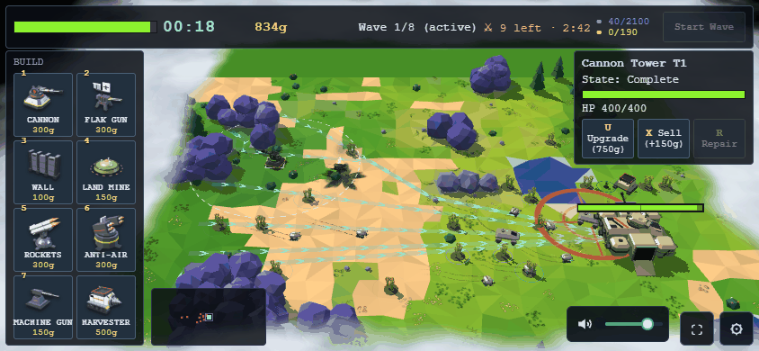 | 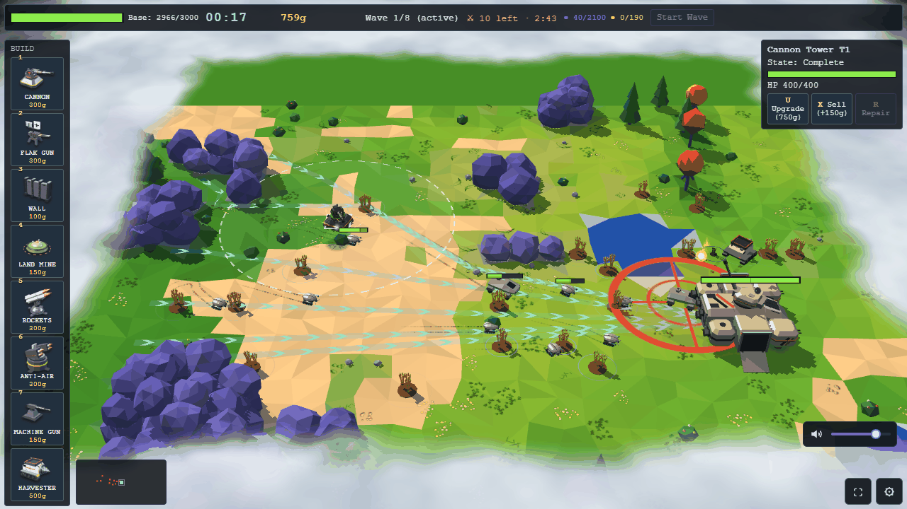 |
| Outpost idle (kit save, offline) | 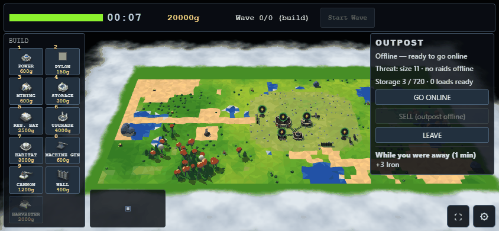 | 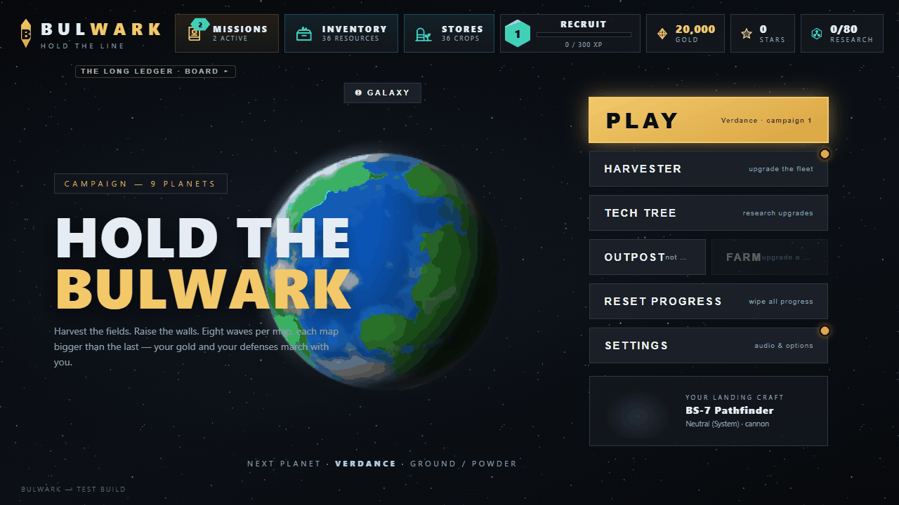 |
| Outpost, defense selected | 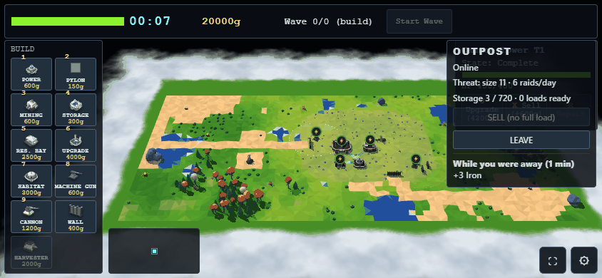 | 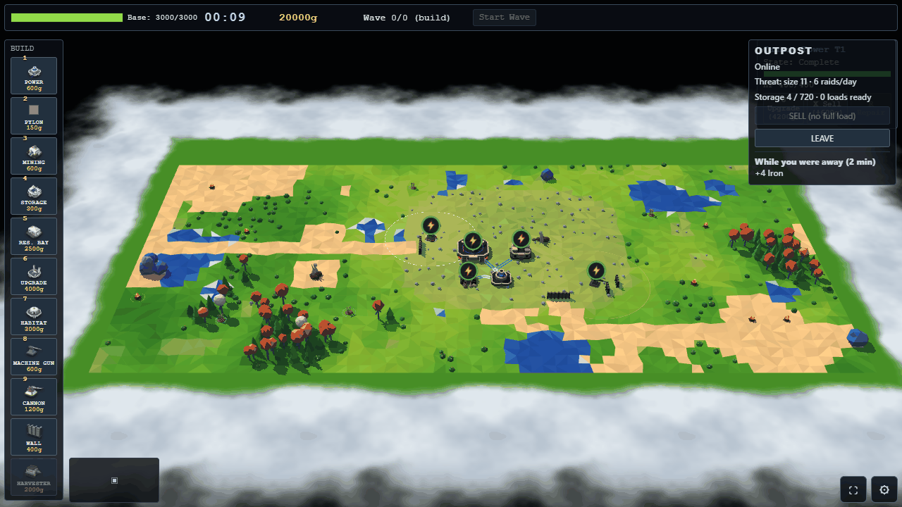 |
| Outpost, visit raid in progress | 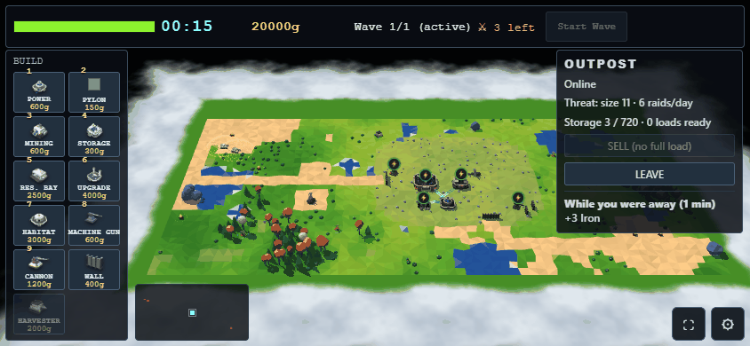 | 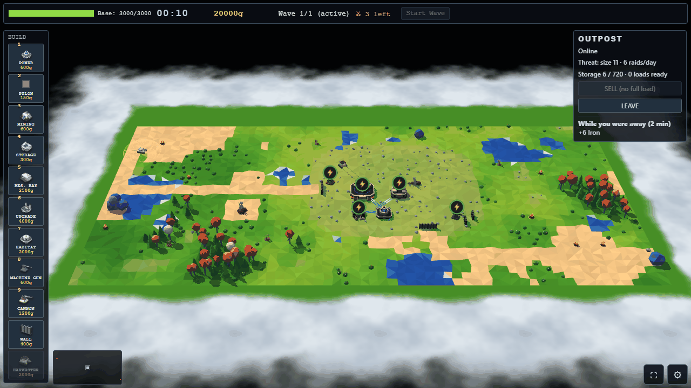 |
| Farm (old view), away report on open | 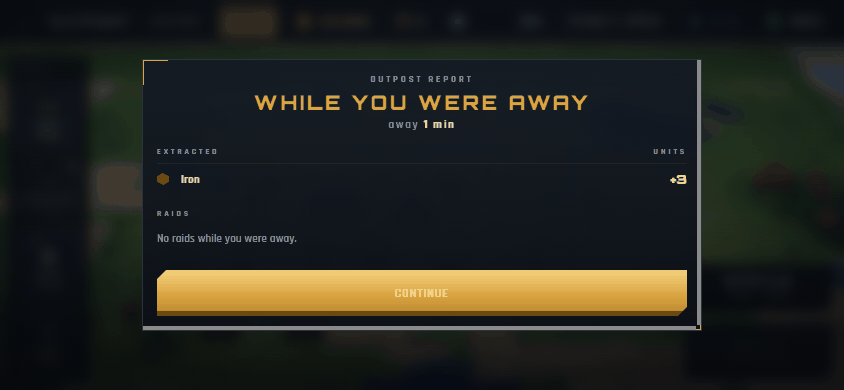 | 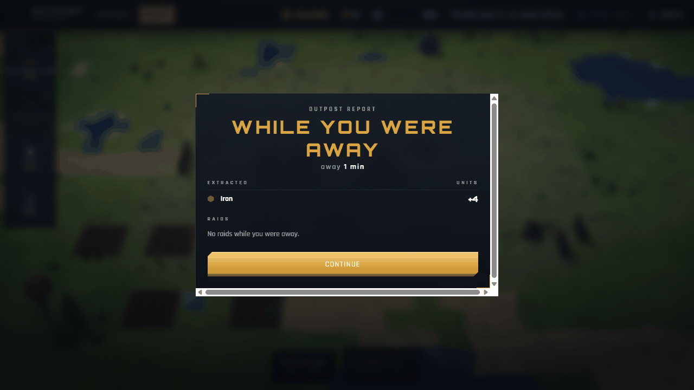 |
| Farm (old view) | 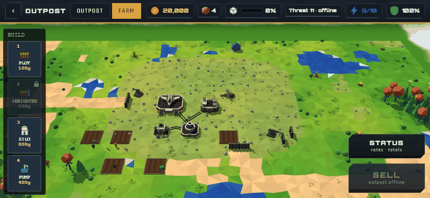 | 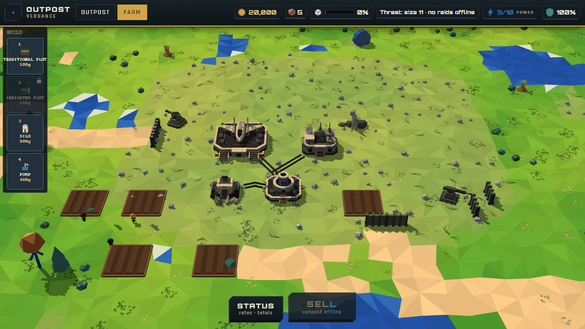 |

What the shots show:
- **Two fonts in one HUD.** The battle HUD is Courier New; the outpost panel next to it is Rajdhani + Orbitron.
- **The outpost panel sits on top of the selection panel.** Both are `right:6–8px; top:56px` — select a defense and
  the battle's panel is hidden behind OUTPOST (`outpost-select-*`).
- **The top bar is the battle's, unchanged**: `Wave 0/0 (build)` and a disabled `Start Wave` mean nothing here.
- **A raid has no announcement.** `Wave 1/1 (active) ⚔ 3 left` is the only sign; the raiders are specks at the board's
  edge (`outpost-raid-*`). The battle announces every wave with its banner.
- **The camera frames the whole 64×32 board.** The base fills ~25 % of the width; the old farm view (closer framing)
  reads much better.
- **The farm is a third style**: gold-trimmed top bar, chips, chamfered STATUS/SELL slabs, a gold away-report modal.
- **Toasts are always red** (`.bw-toast`), even for good news — in battle too (`+159g primary` in red,
  `battle-select-1280x720`), and at the outpost "Sold · +X gold" / "OUTPOST ONLINE".

## Combat tokens (the inventory)

From `src/render/hud.js` (CSS block) and `src/render/buildPalette.js` (`PALETTE_CSS`, `SELPANEL_CSS`,
`paletteBaseCss`). These become CSS custom properties on `.bw-hud` in step 2 (values unchanged), so a mode can never
drift from them.

| token | value | used by |
|---|---|---|
| font | `'Courier New', monospace`, `user-select:none` | whole HUD |
| ink / dim / label | `#e8e8e8` / `#8fa4b8` / `#9ab` (rail title) / `#7f9fb2` (stat keys) | text |
| panel | `rgba(10,14,20,.85)`, `1px #3a4a5a`, radius 4, pad `6px 8px` | top bar, rail, selection panel |
| object window | `rgba(9,14,20,.94)`, `1px #2c3e50`, radius 7, pad `8px 14px`, shadow `0 3px 16px rgba(0,0,0,.55)` | unit panel, resource card |
| button | `#22303e` / text `#e8e8e8` / `1px #4a6076` / radius 3 / pad `4px 8px` / 12px; hover `#2f4356`; disabled `opacity .4` | all buttons |
| button selected | `#3d6a3d` / `#7ac07a` | armed build item |
| round button | 38×38, `rgba(10,16,22,.9)`, `1px #4a6076`, radius 6 | ⚙, ⛶ |
| hotkey glyph | 800 `#ffe58a` (`.bw-key`, `.bw-bkey`) | rail, action row |
| gold | `#ffd76a` bold (money 15px; costs 10px) | money, costs |
| clock | 18px bold `#8fe0ff`, tabular, 1px tracking | wave timer |
| foe | `#ff9d7a` (`⚔ N left · m:ss`) | enemy countdown |
| names | `#bfe0ff` 13px bold (structure); `#ffe58a` 15px 800 (unit) | panels |
| HP bar | track `#34373c`, rim `#141619`, fill `#8cf22e` (`render/hpColors.js`, one palette) | base, selection, units |
| toast | top 70px centred, `rgba(60,20,20,.92)`, `1px #c66`, `#ffd7d7`, 13px, 1.6 s | flashMessage |
| wave banner | 40px 900 `#ff5a3c` + glow, sub 18px `#ffd6c8`; secured `#ffd76a` / `#bff5c8`; 3 s | showWaveBanner / showSecuredBanner |
| CTA | `2px #5fe0ff`, radius 8, pulsing glow | TAP TO START NEXT WAVE |
| minimap | 128×64, `rgba(8,12,16,.82)`, `1px #2a3a4a`, radius 4, parks right of the rail | minimap |
| spacing | 6px screen gutter; panels at `top:56px`; rail gap 4; rail 50–80px buttons, 2 columns when short (`railFit`) | layout |
| phone sideways | `max-height:500px` → top-bar buttons ≥34px tall (A11Y-INPUT-2) | touch |
| icons | baked model picture 48px + `drop-shadow(0 2px 2px rgba(0,0,0,.55))`; SVG glyph fallback; padlock `LOCK_SVG` | rail |
| z-order | HUD 10 · mode panels 20 · minimap 60 · bottom bar 65 · ⚙/⛶ 66 · object window 68 · CTA 70 · dialogs 82 · Kill Cam 150 | layering |
| dialog card | `render/gameDialog.js`: veil `rgba(8,10,14,.74)`, card `#14181f` / `1px #2e3846`, kicker `#d9a441`, gold CTA | how-to-play, wave intel, bonus pick |

Note the HUD and its dialogs already differ (Courier HUD, Segoe UI dialog cards). That split is fine and stays: **HUD =
Courier; modal cards = gameDialog**. The outpost follows the same split.

## Surfaces — combat today · outpost today · target · shared component

**1. Top bar (outpost mode).**
*Combat:* base HP · wave clock · gold · `Wave n/N [phase]` · `⚔ left · m:ss` · quest/contract dots · Start Wave.
*Outpost today:* the same bar, with `Wave 0/0 (build)` and a dead `Start Wave` (`outpost-idle-*`).
*Target:* `[Hub HP] [RAID 1:12 | OFFLINE | 00:41 in a raid] [gold] | [⚡ 9/10] [▣ 3/720] [☠ size 11 · 6/day] … [LEAVE ▸]`.
During a raid the threat chip gives way to the battle's own `⚔ 3 left · 1:19`. No wave count, no Start Wave.
*Shared component:* `render/hud.js` top bar driven by **readouts** a mode supplies (`hud.setReadouts([...])`:
id, glyph, text, colour token, tooltip) and one **primary action** slot (battle: Start Wave; outpost: LEAVE). The
battle's quest/contract/tracked-mission spans become readouts too → identical look, one code path.

**2. Outpost status card** (online, storage/loads, SELL, GO ONLINE, REPAIR ALL).
*Combat:* none (the selection panel is the right-hand card).
*Outpost today:* `op-session-panel` built in `sessionView.js` with inline styles, a second font, full-width
buttons, the away report appended underneath.
*Target:* a **`HudCard`** in the right column: title `OUTPOST · ONLINE` (`#bfe0ff`), key/value rows (`Storage 3/720`,
`Loads ready 0`), a fill bar in the HP-bar style (storage fill), and an action row of hotkeyed buttons
(`GO ONLINE` only while offline; `S Sell`, `Repair all · 450g` only when something is damaged). LEAVE moves to the
top bar. The away report leaves the card (surface 6).
*Shared component:* new `HudCard` in `render/hud.js` (or `render/hudCard.js`): `{ title, rows:[[k,v]], bar, actions:[{key,label,sub,enabled,onClick}] }`.
**The battle's selection panel is rebuilt on `HudCard`** (same pixels), so the two can't diverge. `sessionView.js`
supplies data only; the inline-style block is deleted (and the S7 guard test forbids inline-styled panels in
`src/outpost/**`, `src/farm/**`).

**3. BUILD | FARM rail tabs** (lane L is building the toggle).
*Combat:* the rail's title row reads `BUILD`.
*Outpost today:* `BUILD` (outpost); the old farm view has its own `OUTPOST | FARM` tabs in the gold top bar.
*Target:* the rail's title row becomes two `.bw-btn` tabs, `BUILD` / `FARM`, the active one in the
**button-selected** token (`#3d6a3d` / `#7ac07a`), 10px 800 caps, ≥34px tall on a sideways phone. One catalogue per
tab; switching re-runs `railFit`. With one tab (the battle) the row renders the plain `BUILD` title exactly as today.
*Shared component:* `render/hud.js` rail header (`hud.setRailTabs(tabs, onPick)`) + `battle/catalogue.js`
(`session.setCatalogue`). Lane L owns the code; this spec only fixes the look.

**4. Selection panel** (lane O is fixing which panel shows).
*Combat:* `Cannon Tower T1 · State · HP bar · U Upgrade / X Sell / R Repair`.
*Outpost today:* the same panel, **hidden under the outpost card** (`outpost-select-*`).
*Target:* the battle's panel, pixel-identical, in the right column; the outpost card yields while anything is
selected (**right-column rule**: selection > mode card; one slot, never stacked). Outpost-only facts are extra
rows in the same panel, e.g. `⚡ powered` / `⚡ unpowered — out of reach`, `Repair drone 0:40`, upgrade grid warning.
*Shared component:* selection panel on `HudCard` + `hud.setSideSlot()` priority rule in `render/hud.js`; extra rows
from a mode hook (`selectionExtras(struct)`), never a second panel.

**5. Toasts / notifications.**
*Combat:* one red toast for everything.
*Outpost today:* the same red toast for "Sold · +X gold", "OUTPOST ONLINE …", refusals.
*Target:* `flashMessage(hud, text, kind)` with **kind** `error` (today's red, default — unchanged call sites), `ok`
(`rgba(16,40,26,.92)` / `1px #57a057` / `#c8f5cf`), `info` (panel token / `#cfe3f0`). Long messages (GO ONLINE's
"raiders will come") get 3 s, not 1.6 s. Battle gains use `ok` (`+159g primary`).
*Shared component:* `render/hud.js flashMessage` — one function, a kind argument.

**6. Away report.**
*Combat equivalent:* the end-of-wave report (`render/waveReport.js mountWaveReport`) and the `gameDialog` card.
*Outpost today:* a bold line + rows appended to the side panel (session view); the old farm shows its own gold
Orbitron modal (`farm-*-report`).
*Target:* on arrival, if anything happened, a **report card** in the dialog style: kicker `OUTPOST REPORT`, title
`While you were away · 2 h`, sections *Extracted* (ore rows with the resource dot + units), *Raids* (each: when,
result, losses, bounty), *Built*; one gold CTA `CONTINUE`. Tap anywhere outside = continue. Nothing about pods or
chest progress, ever.
*Shared component:* `render/waveReport.js` (or `gameDialog.js` shell) with an away-report model from
`outpost/view/awayReport.js` (already a pure model). The farm's own modal is deleted with the old farm HUD.

**7. Raid warning / in-raid HUD.**
*Combat:* `showWaveBanner` ("<Faction> Incoming, prepare for attack!"), `⚔ left · m:ss`, red minimap dots,
`showSecuredBanner` on a clear.
*Outpost today:* nothing but the top-bar text; raiders are invisible specks.
*Target:* on a probe's start, `showWaveBanner(hud, 'Raiders')` → **RAIDERS INCOMING, hold the line!**; the top-bar
clock becomes the raid's `⚔ 3 left · 1:19`; when it clears, `showSecuredBanner` → **Raid repelled · +120g bounty**;
an **off-screen threat pointer** (red chevron at the screen edge toward raiders outside the view) until they are
on screen. The first raid of a visit also pulses the minimap border once.
*Shared component:* the battle's banners/readouts as they are (the outpost only calls them from `visitRaids.step()`'s
return), plus the **new off-screen pointer in `render/hud.js`**, fed attacker positions by the session — the battle
gets it too (useful on large maps).

**8. Power / threat readouts.**
*Combat:* none (the battle has no grid or raid schedule).
*Outpost today:* threat is a text line in the card; power only shows as icons over buildings.
*Target:* top-bar readout chips (surface 1): `⚡ used/capacity` (amber `#ffd76a` when ≥ 90 %, red `#ff9d7a` when
over), `▣ storage`, `☠ size · raids/day`. Tapping a chip shows a one-line `info` toast explaining it. The battle's
ghost already turns amber when a build would be unpowered — unchanged.
*Shared component:* the readout API (surface 1).

**9. Opening camera framing.**
*Combat:* `render3d` auto-frames the play area (the fog window) inside the HUD's insets.
*Outpost today:* the play area is the whole board, so the base is small (`outpost-idle-*`).
*Target:* open framed on the **base footprint** (bounding box of the outpost's structures + 6 cells, never smaller
than 24×12 cells), inside the same HUD insets; pinch/scroll zooms out to the whole board as in battle. After a
raid's banner the camera does not move (the pointer guides the eye).
*Shared component:* `render3d/index.js autoFrame` — `playRect` takes an optional mode rect
(`mountOptions().frameRect`). The battle passes none → unchanged.

**10. Farm plots / crop interactions** (after lane L's FARM tab).
*Combat:* build rail → ghost → place; tap a structure → selection panel.
*Farm today:* old view: its own rail look, chamfered STATUS/SELL slabs, its own pointer code.
*Target:* the FARM tab lists PLOT, IRRIGATED, SILO, PUMP in the battle rail (padlock for locked). Tapping a plot
opens the **selection panel**: name `Plot 3 · Traditional`, state row `Wheat · 64 %` with the progress in the HP-bar
slot (a plot's "health" is its growth), actions `P Plant` / `H Harvest` / `X Clear`; **Plant** swaps the action
row for crop buttons (rail-button look: picture, name, time) — no new panel. `Harvest all` and farm STATUS are rows/actions on the
outpost card. SELL is the card's one SELL.
*Shared component:* rail + selection panel + `HudCard`; farm supplies data and commands only (S6 of the plan).

## Layout sketches (landscape phone, 844×390)

Rendered from `outpost-aaa/mock.html` with the battle's token values (grey squares stand in for the rail pictures).

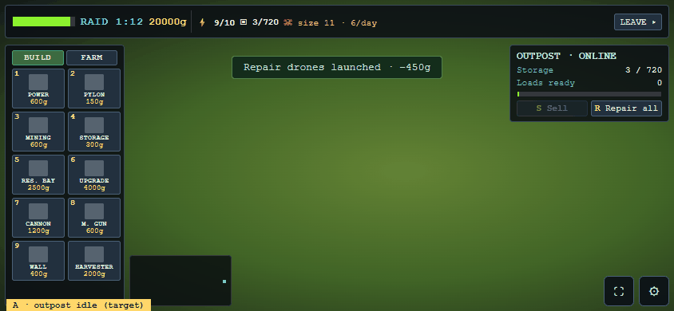
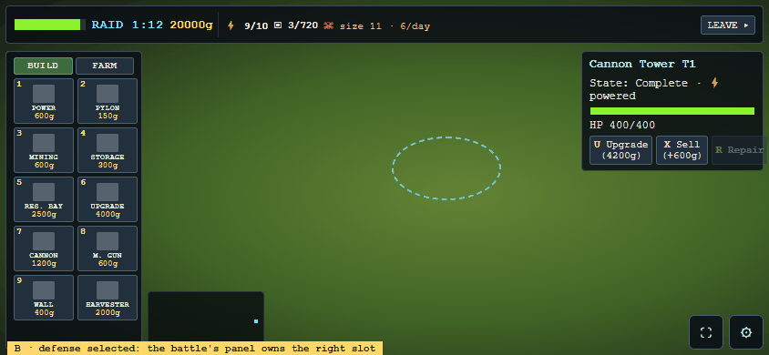
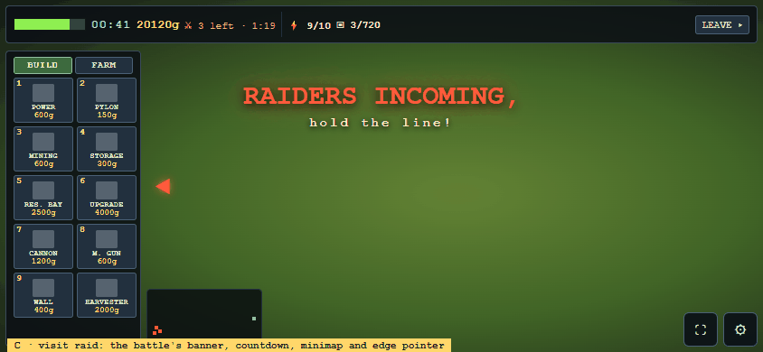

```
┌───────────────────────────────────────────────────────────────────────────────┐
│[███▒ hub] RAID 1:12  20000g │ ⚡9/10  ▣3/720  ☠ size 11·6/day        [LEAVE ▸] │  top bar = battle bar + readouts
├────────────┐                                                ┌─────────────────┤
│[BUILD|FARM]│                                                │ OUTPOST·ONLINE  │  right column: ONE slot —
│ 1▣  2▣     │              (camera framed on the base)       │ Storage 3/720   │  selection panel wins,
│ 3▣  4▣     │                                                │ ▕█░░░░░░░░░░▏   │  outpost card otherwise
│ 5▣  6▣     │                                                │ [S Sell][R Rep.]│
│ 7▣  8▣     │                                                └─────────────────┤
│ 9▣  H▣     │ [minimap]                                               [⛶] [⚙] │
└────────────┴──────────────────────────────────────────────────────────────────┘
```

## What the combat screen gains (so both stay identical)

| shared piece | battle change | outpost/farm use |
|---|---|---|
| `HudCard` | selection panel rebuilt on it, same pixels | outpost card, plot panel |
| top-bar readouts + primary action slot | quest/contract/mission spans become readouts, same pixels | ⚡ ▣ ☠ chips, RAID clock, LEAVE |
| right-column slot rule | none visible (one card today) | card yields to selection |
| toast kinds | gains (`+159g primary`) turn green | sold / online / repair toasts |
| off-screen threat pointer | new: chevron toward off-screen attackers | raiders |
| rail tabs header | renders `BUILD` as today | BUILD / FARM |
| `autoFrame` mode rect | none (no rect passed) | framed on the base |

Deleted in step 2: the inline `op-session-panel` block in `sessionView.js`; the old farm HUD (`outpost/view/hud.js`
`HUD_CSS`, away-report modal) once lane L's FARM tab lands. Guard: extend `uxGuard.test.mjs` / S7 so `src/outpost/**`
and `src/farm/**` cannot set panel styles inline or inject HUD CSS.

## Owner decisions

| # | question | recommendation |
|---|---|---|
| D1 | HUD font: keep the combat screen's Courier New for both modes, or move both to Orbitron/Rajdhani (the menu's)? | **Keep Courier New.** You said combat looks good; zero risk to it. Dialog cards keep their own sans. |
| D2 | Top-bar clock at the outpost: next-raid countdown (`RAID 1:12`) when online, `OFFLINE` when not? | **Yes.** It's the outpost's one tension timer. (It's not pod/chest progress.) |
| D3 | Outpost card placement: right column, hidden while something is selected? | **Yes** — one slot, selection wins; deselect brings it back. |
| D4 | LEAVE: top-bar right (where Start Wave sits), or inside the card / ⚙ menu? | **Top-bar right**, always visible. |
| D5 | Away report: a modal card on arrival (battle's wave-report style), or inline in the card? | **Modal card on arrival**, once; only when something happened. |
| D6 | Toast kinds: green for good news, red for refusals — in the battle too? | **Yes, both modes.** The only visible combat change. |
| D7 | Camera opens framed on the base footprint (zoom out for the whole board)? | **Yes.** |
| D8 | Off-screen threat pointer — new for both modes? | **Yes**, small red chevron; off when attackers are on screen. |
| D9 | Farm plot = the battle selection panel (growth in the HP-bar slot, Plant/Harvest/Clear actions)? | **Yes.** |
| D10 | Hotkeys on the outpost card: `S` Sell, `R` Repair all when nothing is selected (`R` = Repair the selection otherwise)? | **Yes** — same key, same meaning, scoped by selection. |

## Step 2 (implementation) outline — for planning, not done here

1. Tokens → CSS custom properties on `.bw-hud` (values unchanged); `HudCard`; selection panel on it (battle pixel-diff
   by screenshot at both sizes). 2. Readouts + primary action; toast kinds. 3. Outpost card on `HudCard`; delete the
   inline panel; right-column rule. 4. Raid banners + off-screen pointer. 5. `autoFrame` mode rect. 6. Away-report card.
   7. Farm plot panel (after lane L). 8. Guard test. Each step: full local suite + captures at 844×390 and 1280×720.

## Dependencies

| relation | document | what it holds that this spec does not restate |
|---|---|---|
| depends-on | docs/16 Bulwark MM/tech-plan/One-Battle-UX.md | the shared battle session every surface here sits on |
| related | docs/16 Bulwark MM/design/Outpost-Design.md | outpost rules (raids, power, storage, sell) behind each readout |
| related | docs/16 Bulwark MM/design/Farming-Design.md | farm plots, crops and methods the FARM tab lists |
