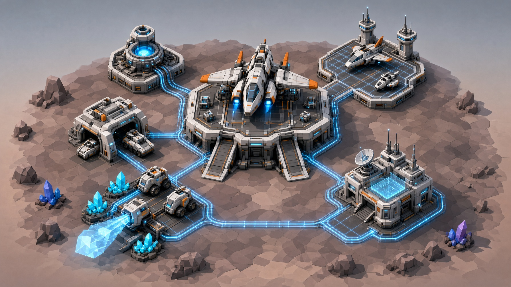

# Outposts and Mining — design

Status: **"The rules today" (below) is the current, as-built rule set (2026-11-09)**; the rest is the design history — owner decisions (Q1–Q7, 2026-11-06; build-it-yourself start and storage/power rules, 2026-11-07); bays, Outpost tech and Habitat as built (O10, O15) · Epic *Outposts and mining* (initiative *Bulwark advanced mode*, L3)
· Tech plan: `docs/tech-plan/Outpost.md` · Concept art: the owner's outpost image (2026-11-06), described in §8

## The rules today (as built, v2026.11.09)

> **owner** (2026-11-09): "the outpost rules are too obscure .. please give me an updated outpost design document so
> we can update it."

This section is the outpost as the game plays it today, in plain rules. Every number comes from the map-data workbook
(`Outpost_Params`, `Outpost_Structures`, `Outpost_Contracts`, `Outpost_Tech`, `Ores`, `Outpost_Raids`), so a change
there changes the game. Everything after this section is the design history: the owner's directions, the proposals
and the as-built notes that led here. Where the two disagree, this section is what the game does. Numbers are
Verdance's; every planet uses the same rules with its own three ores.

### R1. Getting an outpost

- **The contract.** A capital ship's captain offers the outpost contract. Accepting it grants an **Outpost Hub** on the
  planet's outpost map. Everything else is bought with gold.
- **The Outpost button** on the main menu opens it once the contract is accepted.
- **Going online.** The outpost runs its economy only after it is online. GO ONLINE becomes available when four
  buildings are finished and powered: the **Hub**, a **Power Station**, a **Mining Station on the common deposit**
  (Iron on Verdance) and a **Storage Tower**. The GO ONLINE card lists what is still missing.
- **The first raid** comes 10 minutes after going online. It is a small probe.

### R2. The map

- The outpost sits on a raised **mesa** in the middle of the map. Raiders reach the top only by its **ramps**.
- **Pads** on the mesa hold the buildings: the hub is 3 × 3 cells, every other pad 2 × 2. Each ore deposit has a pad
  over it, and only a Mining Station can go there.
- **Defenses** (walls and guns) take single cells anywhere on the mesa that is not a pad, including the rim.
- A **remote site** in the lowland holds the rare deposit and its own Power Station pad.

### R3. Power

- Every building but the Power Station and the Habitat **draws power**: Hub 2, Mining Station 4, Resource Bay 2,
  Storage Tower 1, Upgrade Bay 1, each gun 1. Walls draw nothing.
- A **Power Station** supplies **10** to buildings within **10 cells** (Power Station II: 20 within 14 cells).
- A building out of reach, or over the station's supply, is **unpowered**. An unpowered building **stops working**,
  but **keeps what it has stored**. An unpowered Storage Tower **shuts its door** and takes no new ore.
- The top bar shows power as used / supplied (for example 9/10). It turns red when short.

### R4. Mining and storage

| Ore (Verdance) | Tier | Mined per minute | Sells for (gold / unit) |
|---|---|---|---|
| Iron | common | 3 | 4 |
| Aluminum | uncommon | 1.5 | 12 |
| Lithium | rare | 0.8 | 30 |

- A **Mining Station** on a deposit mines while it is **powered**, even before the outpost is online.
- The miner's ore goes on to the **Storage Tower** each tick. A finished, powered tower holds **4 hours** of each
  rig's output (Storage Tower II: 8 hours).
- Each Mining Station also has its own **bay** of **15 minutes** of its output. With no Storage Tower (or its door
  shut) that is all it holds.
- When the tower's bay for a rig is **full**, the tower shows **storage full** and the miner keeps running into its own
  bay. When that is full too, the miner **stops** and shows **storage full** (owner 2026-11-09: "If storage fills, the
  miner can run until it is full, full a miner has to stop there is a warning icon for storage full. Storage also has
  an icon storage full."). A rig's panel shows *In storage* and *In the miner*.
- **Deep seam** (after the Deep Drilling I tech): a rig switched to *Deep* mines at **¼ the speed** but each unit sells
  for **5×** the price.
- **Mining Station Mk II** (Rig Mk II tech): **2×** the rate and **2×** the bay.

### R5. Selling

- Ore sells in **loads**. A load is **5 minutes** of that rig's output (Iron: 15 units = 60 gold).
- **SELL** (bottom right, and **SELL RESOURCES** on a rig's or storage tower's panel) sends every **full load** to the
  capital ship for gold. A part load stays until it fills.
- SELL is greyed out with "no full load" when nothing is ready, and "outpost offline" before the outpost is online.
- Selling is always a **tap**: the outpost never sells by itself.
- **Cargo Shuttle II** (tech): **+10%** on every sale.
- **The far buyer** (after contract step 3): another faction pays **2×** for its ore, but each load sold costs
  **1 loyalty** with the home faction.

### R6. Buildings

| Building | Cost | Build time | What it does |
|---|---|---|---|
| Outpost Hub | granted | — | The centre. Crews **3 guns** (Machine Guns and Cannons; walls do not count). |
| Power Station I / II | 600 / 6,000 | 2 / 15 min | 10 power in 10 cells / 20 power in 14 cells |
| Mining Station I / Mk II | 600 / 8,000 | 2 / 20 min | Mines its deposit (R4) |
| Storage Tower I / II | 300 / 5,000 | 1 / 15 min | Every rig's bay holds 4 / 8 hours |
| Resource Bay | 2,500 | 5 min | Fields **harvesters** for the surface fields (R7) |
| Upgrade Bay | 4,000 | 10 min | Upgrades defenses, one at a time, on its pad (R8) |
| Habitat I / II | 3,000 / 5,000 | 10 / 15 min | **+2 guns** per tier over the hub's 3 |
| Machine Gun I / II / III | 600 / 1,500 / 3,000 | 2 min | Defense |
| Cannon I / II / III | 1,200 / 3,000 / 6,000 | 2 min | Defense |
| Wall I / II | 400 / 1,000 | 2 min | Blocks a cell. No power, not a gun. |

- A building **under construction** shows dust and welding sparks, and does nothing until it is finished.
- **Sell** (X on a building's panel) refunds **50%** of what it cost.
- **Repair** (R on a defense, or REPAIR ALL) costs the defense's **value × the share of its HP that is missing**: a
  Machine Gun I at half HP costs half its value to repair.
- A **damaged defense throws red sparks** until it is repaired (more the worse it is).
- Defenses cost **4×** their battle price: an outpost defense lasts for days, not one map.

### R7. Harvesters (the surface)

- A **Resource Bay** lets you buy **harvesters** (2,000 gold each). An outpost starts with room for **2**, at most 4.
- A harvester works the **surface fields** off the mesa at the battle's rate, and hauls into the Resource Bay's hopper
  (4 hours).
- Outpost fields **regrow slowly**: at **5%** of a battle field's rate, so a field worked hard runs dry.

### R8. Defenses and upgrades

- Only **Machine Guns, Cannons and Walls** can be built at an outpost.
- The **gun cap** is 3 from the hub, plus 2 per Habitat tier. The build list greys a gun out at the cap.
- **Upgrades** need the tier in the Tech Tree *and* an Upgrade Bay. The defense goes to the bay's pad while it is
  upgraded (a timed job) and does **not fight** until it comes back.

### R9. What the markers mean

A big round marker over a building is a **warning**. Tap the building to read it in its panel.

| Marker | Meaning | What to do |
|---|---|---|
| **Crate** (gold ring) | **Storage full**: on the Storage Tower, its bay for a rig is full (that miner is filling its own bay); on a miner, its own bay is full too and it has stopped | **SELL** |
| **Lightning bolt** | **No power**: the building is stopped (its storage is kept) | Build or move a Power Station within reach, or add supply |
| **Door** | **Door shut**: an unpowered Storage Tower takes no new ore | Restore its power |

### R10. Raids

- Once online, raids come on average **every 6 hours**, never less than **3 hours** apart. The first is 10 minutes
  after going online.
- Raiders are the planet's faction's own units (Verdance: troops and tanks), weaker than in battle (80% HP, 50% damage).
  They climb the ramps and go for the buildings.
- **Held**: no raider reaches a building. Damaged defenses keep their damage until repaired.
- **Breached**: a raider reaches a building, or stands in firing range of the hub. The outpost loses **25%** of the ore
  in every bay.
- The **Sensor Spire** tech shows a raid inbound 10 minutes ahead (the top bar's raid timer).

### R11. While you are away

- The outpost keeps running while the game is closed, for up to **72 hours**. Mining, storage, raids and repairs are
  worked out when you come back.
- The **away report** on landing says what happened: ore mined, raids held or breached, what is full.
- **STATUS** shows lifetime totals and the current collection rates per hour.

### R12. The contract ladder (per planet)

| Step | Asks | Pays | Unlocks |
|---|---|---|---|
| 1 · Establish (Iron) | Deliver 300 Iron and hold 1 raid | 2,000 gold, 20 loyalty | Aluminum; techs Deep Drilling I, Supply Depot, Power Grid II, Reinforced Walls |
| 2 · Expand (Aluminum) | Deliver 150 Aluminum | 4,000 gold, 30 loyalty | Lithium; techs Rig Mk II, Sensor Spire |
| 3 · Master (Lithium) | Deliver 60 Lithium and hold 3 raids | 8,000 gold, 40 loyalty | Cargo Shuttle II tech; the far buyer |

### R13. Outpost tech (bought in the Tech Tree)

| Tech | Price | Effect |
|---|---|---|
| Deep Drilling I | 3,000 | The deep seam: ¼ the speed, 5× the price |
| Supply Depot | 4,000 | Storage Tower II: 8 hours per rig bay |
| Power Grid II | 4,000 | Power Station II: 20 power, 14-cell reach |
| Reinforced Walls | 2,500 | Walls to tier II, in the Upgrade Bay |
| Rig Mk II (needs Deep Drilling I) | 6,000 | Mining Station Mk II: 2× rate, 2× bay |
| Sensor Spire | 3,500 | Raid warning 10 minutes ahead |
| Cargo Shuttle II | 10,000 | +10% on every sale |

### R14. Open for the owner

- ~~Part loads~~ — answered 2026-11-09: SELL sells whole loads only, never a part load (R5).
- ~~Stopped rigs~~ — answered 2026-11-09: the miner runs on into its own bay when storage is full, then stops (R4).
- The gun cap and the Habitat: are 3 guns + 2 per Habitat tier the intended limits?
- Harvester cap 2, maximum 4: what raises it (it is not in the build list today)?

---

*The design history starts here: owner directions, proposals and as-built notes, oldest first.*

## Owner direction (2026-11-06)

> We need a design for the first contracts. When a player arrives at the capital ship the contract will be for a mined
> resource. A requirement for the contract will be to successfully start your outpost on the active planet.
>
> For example if the player has just earned 3 stars on map 3 of Verdance they discover the Verdance capital ship.
> Verdance faction acknowledges the progress on Verdance and offers a distraction. "You have done so well gathering
> surface resources on Verdance, how are you at mining and farming?" The player is given a small outpost and a mining
> rig: outpost building, power station, miner, and a storage tower. "Not everybody in this faction is happy about your
> progress but you will gain some moral equity by helping us gather the ore. There will be opposition but we will pay
> well for these resources."
>
> We will need another unique map for Verdance and the other planets for the outpost. We will also need the new
> structures and game mechanics. […] On the main menu "Replay Last Battle" will become the Outpost button which is
> only clickable when the Outpost is contracted. Replay will be a feature on the game history pages. […] We will need
> new 3D models. In the picture you also see an upgrade bay which can be used to add upgrades from the tech tree, and
> a harvester bay so the player can also run a resource harvest for the surface and build new ones just like in the
> tower defense game.
>
> Outposts will see light attacks occasionally so they should have defenses but these occur rarely so a well defended
> Outpost can stay running for up to 2 days without new construction. The mining storage will have enough resource to
> sell every 5 minutes and the storage building can hold 4 hours of resources. Upgraded mining buildings can dig deeper
> for higher quality ore which gets collected at 1/4 the speed but sells for 3x as much.
>
> Contract success will unlock the second ore and mining technology. Each planet has 3 ores to collect just like the
> resources gathered on the surface: uncommon, common and rare. The ores on Verdance will be iron, aluminum, and
> lithium, used to build outposts and spacecraft. The next planet will supply magnesium, boron, cobalt for enhanced
> materials and power stations. We should be able to fill in the rest of the planets. These resources will sell for
> gold to be used to construct Outposts, mining equipment, and eventually spacecraft.

### Owner decisions (2026-11-06)

> 1. Yes, 2. Ground defenses cannon and machine gun, and walls 3. Raise the price 4. Ores are good 5. Harvesting ore
> selling is always a manual tap with a cool shuttle animation, ore splatter, and a dollar value animation just like
> in combat 6. When raids break through 25% of ore is lost. 7. Yes, I simplified to 3 for now.

> The ore mining towers for different materials should be different designs, while the 2x miner simply uses a
> different highlight color with an enhanced mining animation. More debris. *(owner, 2026-11-06, 16:53)*

> Mk II rig should have double capacity, but deeper definitely works better when slower. Eventually when the player
> advances they may discover the Easter egg that other factions will pay even more for rare resources from other
> planets. *(owner, 2026-11-06, 18:30)*

> The power station can be upgraded or the player can build multiple power stations, power stations also have
> proximity so a remote build on the map needs another power station. Can we model defense off the numbers used in the
> tower defense game. Outposts don't have anti air for now and they don't have long range. Outposts will only be
> attacked by troops and low end tanks. *(owner, 2026-11-06, 18:48)*

### Owner direction (2026-11-07): the player builds the outpost

> building an outpost should be done the same way the tower defense game works. An icon list with cost on the left
> side of the screen with icons and prices. The user start with the base building and use their own gold to build
> power and a mining station. Harvester can be purchased and there is a limited set of defenses - wall, machine gun,
> turret tower.

Answers to the follow-up questions (2026-11-07): the turret tower **is** the battle game's Cannon Tower, so the
defenses are the Wall, the Machine Gun and the Cannon Tower at their battle stats; harvesters "are bought from the build
list but they can't be built until the resource bay is constructed", so the Harvester Bay becomes the **Resource
Bay**, a building the harvesters need; the Upgrade Bay is unchanged.

> A mining structure with no storage still mines but it has very low capacity. Buildings with full storage or no
> electricity show a warning. no electricity means no operation but the storage is maintained, but a storage tower with
> no electricity has a closed door and wont take new resources. *(owner, 2026-11-07, 07:33)*

This replaces an earlier answer the same morning that the Storage Tower was needed before any mining ran. The Storage
Tower is still part of the contract's first step (§2.3). The rules are in §2.3, §4.2, §4.5, §6 and §11.

The first build is **the Verdance contract plus the Verdance outpost map** (Q1). The answers are applied throughout;
§11 records them. ("sooner animation" in the reply is read as *shuttle* animation.)

## 1. What the outpost is

The battle game is played in sessions: land, hold eight waves, leave. The outpost is the part of Bulwark that keeps
running when the player is not playing. It is a small base on a planet's surface that mines ore and harvests the
surface on its own. Every few minutes the ore is ready to fly up to the capital ship and sell. Once in a while
dissidents raid it.

It gives the player three things the battles do not:

- **A reason to come back several times a day.** A shuttle load is ready every 5 minutes, and storage fills in 4 hours.
- **A gold income that grows.** It pays for outposts, mining equipment and, later, spacecraft.
- **A second relationship with each faction.** The faction pays for the ore and grows to trust the player. Not every
  member of the faction approves, and that is where the raids come from.

It is not a second tower-defense game. A raid is small and rare, and a well built outpost holds for about two days
without the player touching it.

## 2. Where it starts: the first contract

### 2.1 The trigger

The trigger is unchanged from Content-Reveal: map 3 of a planet won at 3★ or better brings that faction's capital
ship. On the first visit aboard, the faction officer greets the player and the contract card comes up. **The first
contract on every faction ship is the outpost contract.** The ship's campaign missions (map 4 onward) are presented
in the same visit, as they are today.

### 2.2 The scene, Verdance

The scene uses the Content-Reveal boarding sequence: walk to the helm, the captain turns, comm lines, contract card.
The speaker is the ship's captain, Colonel Aldric Vane. These are draft lines; the owner's own words are kept where
they were given.

| Beat | Speaker | Line |
|---|---|---|
| greet | Vane | "You have done well gathering what lies on the surface of Verdance. Better than most of my own regiments." |
| turn | Vane | "So tell me: how are you at mining? And farming?" |
| offer | Vane | "We have a site for you: an outpost base on the mesa. Build your power, a mining station on the iron and a storage tower with your own gold, and the place is yours to run." |
| warning | Vane | "Not everybody aboard is happy about your progress. Help us bring up the ore and you will earn some moral equity with the realm. There will be opposition. We will pay well." |
| card | — | Contract card: **Outpost contract: Iron for the Oath** (§2.3) |

ACCEPT grants the outpost's base, the Outpost Hub, and lights the OUTPOST button on the main menu. Declining keeps the card in the Mission
Log, where it can be accepted later. It costs nothing, because this contract is the gateway to the outpost and must
not be lost.

### 2.3 The contract

| | Verdance, contract 1: *Iron for the Oath* |
|---|---|
| Granted | aboard *Halbrecht's Oath*, first visit |
| Granted | **the Outpost Hub**, on its pad (owner, 2026-11-07). The player buys everything else with their own gold from the build list (§6, §6.1): the Power Station, the Mining Rig (the "mining station"), the Storage Tower, and the defenses they choose. Nothing else is granted. |
| Step 1 | **Establish the outpost on Verdance.** Build power, a mining station on the iron and storage, all powered: the hub, a Power Station, a Mining Rig on the iron deposit and a Storage Tower, all finished and powered. The outpost reads ONLINE. A rig mines as soon as it has power, even with no tower (§4.2), but the step asks for the tower. |
| Step 2 | **Deliver 300 iron to the Oath.** That is 20 shuttle loads, about 100 minutes of the starter rig. |
| Step 3 | **Hold the outpost through a raid.** The first raid is scripted for 10 minutes after the outpost comes online, so it normally arrives while the player is watching (§5.3). If the player has left, it runs on its own (§5.3). If it breaks through, the step waits for the next raid the outpost holds; nothing fails. |
| Pays | 4 gold per iron delivered (contract price, the same as market), then **2,000 gold**, **+20 loyalty with Verdance** ("moral equity"), 300 XP |
| Unlocks | **Aluminum**, the second ore, and **Deep Drilling I**, the first mining technology (§4.4) |

Each planet's first contract has the same shape: establish, deliver its common ore, hold the first raid. Only the
names and lines change. Its gate is `capital_ship_arrived` for that planet, so a player who reaches several ships
gets several outposts, one per planet.

### 2.4 The contract ladder per planet

| Contract | Ask | Unlocks |
|---|---|---|
| 1 — establish | outpost online; deliver 300 common ore; hold the first raid | the uncommon ore; Deep Drilling I |
| 2 — expand | add power (upgrade to Power Station II or build a second station; the first setup with a Machine Gun and a Cannon leaves 1 power spare and a rig needs 4) and a second Mining Rig on the uncommon deposit; deliver 150 uncommon ore | the rare ore; Rig Mk II (2× extraction, 2× storage) |
| 3 — master | build a rig on the remote rare deposit, with the power station it needs there (§4.5); deliver 60 rare ore; hold 3 raids without a breach | Cargo Shuttle II (+10 % on every sale, §4.3); the planet's spacecraft blueprint (later, Ships division) |

Only contract 1 is specified to build. Contracts 2 and 3 fix the direction and the unlock order; their numbers are
set with the ore table once contract 1 has been played.

## 3. Ores

Each planet has three ores, the same tiers as its surface resources: **common, uncommon, rare**. Ores are a separate
family from the surface resources. Surface resources come from battles and the Resource Bay's harvesters; ores come only from
mining rigs. Each planet's ores lean toward a use, so that later crafting has a reason to need more than one planet.

| # | Planet | Common | Uncommon | Rare | Used for |
|---|---|---|---|---|---|
| 1 | Verdance | Iron | Aluminum | Lithium | outposts, hulls, batteries — the basics of building anything |
| 2 | Florael | Magnesium | Boron | Cobalt | enhanced (light, strong) materials and power stations |
| 3 | Ochre | Silicon | Copper | Gallium | electronics, sensors, solar arrays |
| 4 | Kessra | Nickel | Chromium | Tungsten | armour plate and ordnance |
| 5 | Rime | Manganese | Titanium | Vanadium | hull alloys for cold and vacuum |
| 6 | Cinder | Zinc | Platinum | Iridium | heat-proof parts and reactor catalysts |
| 7 | Lumen | Thorium | Uranium | Helium-3 | reactor and drive fuel |
| 8 | Xenthe | Neodymium | Yttrium | Europium | magnets, shields and energy cells (rare earths) |
| 9 | Vexmire | Sulfur | Phosphorus | Palladium | fuels, chemistry and catalysts |

Rows 1 and 2 are the owner's. Rows 3–9 are proposed. They follow each planet's identity (Faction-Terrain-Design §3):
Ochre is solar and mega-corp electronics, Kessra the siege foundry, Rime the cold sea, Cinder fire, Lumen the
airless survey moon, Xenthe dark energy, Vexmire the toxic swamp. All 27 are real elements with no repeats. Kessra's
surface already has *Slag Iron* and *Mesa Copper*; they stay surface salvage, and the mined ores are Verdance's
Iron and Ochre's Copper.

## 4. How mining works

### 4.1 The numbers that are fixed by the owner

- **A shuttle load every 5 minutes.** A load is 5 minutes of what the outpost extracts.
- **Storage holds 4 hours.** Storage Tower I holds 4 hours of the starter rig.
- **Deep ore: ¼ the speed, a higher price** (Q3: raised to 5×).
- **Up to 2 days without new construction** for a well defended outpost.

### 4.2 Extraction rates and prices (proposed defaults)

The same rig extracts each tier at a different speed; rarer ore is slower and worth more per hour.

| Tier | Rig I speed | Price | Gold per hour | Shuttle load (5 min) |
|---|---|---|---|---|
| Common (Iron) | 3 units / min | 4 gold | 720 | 15 units |
| Uncommon (Aluminum) | 1.5 units / min | 12 gold | 1,080 | 7.5 units |
| Rare (Lithium) | 0.8 units / min | 30 gold | 1,440 | 4 units |

**Storage is counted per rig.** Each rig fills its own bay in the Storage Tower, and a bay holds **4 hours of that
rig's shallow output** (owner: "the storage building can hold 4 hours"):

| Rig on | Rig I bay | Rig Mk II bay (owner: double capacity) |
|---|---|---|
| Iron (common) | 720 units | 1,440 units |
| Aluminum (uncommon) | 360 units | 720 units |
| Lithium (rare) | 192 units | 384 units |

So adding a rig or upgrading one never shortens the 4 hours. Storage Tower II doubles every bay (8 hours). A bay counts
units (crates), so a rig on its deep seam fills its bay four times slower (§4.4). When one bay is full only that rig
stops; the others keep going.

**A rig without a Storage Tower** (owner, 2026-11-07: "a mining structure with no storage still mines but it has very
low capacity"). Each rig has a small bay of its own: **15 minutes of its shallow output** (`Rig_Bay_Min`, proposed
default), three shuttle loads. That is 45 iron, 22.5 aluminum or 12 lithium for a Rig I, doubled for Mk II. With
no tower, or with a tower that has no power, a rig fills only this bay and then stops. A finished, powered Storage
Tower raises every rig's bay to the 4 hours above. The bays stay per rig: the tower makes each one bigger.

**Power and storage** (owner: "no electricity means no operation but the storage is maintained"):

- A rig without power does not mine. What it has stored stays.
- A Storage Tower without power has its **door closed**: it takes no new ore, and the rigs fall back to their own
  small bays. Ore already in it stays, nothing is lost, and the hub can still ship it on SELL. Selling is the hub
  launching the shuttle, so stored ore always sells. A rig whose bay already holds more than its own small bay
  simply mines nothing until the tower has power again.
- A rig mines as soon as it is built and powered, before the outpost goes online.

**What 4 hours is worth.** A full Rig I bay of iron sells for 2,880 gold. A Verdance mission primary pays
about 700–1,100 gold, and a won battle banks what is left of its gold. So 4 hours of a starter outpost is worth
roughly one good battle. It is meaningful, but it does not replace playing. The whole tech tree costs 140,300 gold
(Mission-Log §1.2); the outpost is the steady income that closes the late-game gap the battles leave.

### 4.3 Selling

Selling is **always a manual tap** (Q5). There is no automatic selling at any tier.

- When the storage holds at least one load, the hub shows **LOADS READY**, and the menu's OUTPOST button gets a red
  dot.
- **SELL** sells every full load in storage to the planet's capital ship. A partial load stays. The tap plays the
  sale the way combat plays a harvester delivery:
  1. the storage tower's hologram drains and the ore crates ride the conduit to the landing pad;
  2. the shuttle lifts off the hub with a burst of **ore splatter**, chunks of the ore in its colour spraying from
     the cargo bay;
  3. the **"$N" pops** over the hub, the same pop, rise and fade as a kill's bounty or a harvester's delivery in
     battle (`overlays/goldPopups.js`), one per load, stacking upward and in the ore's colour;
  4. the shuttle arcs up and out of frame, and the gold counter in the HUD counts up.
- The buyer is the planet's own faction ship, at the contract price while a contract is active and the market price
  after. The defaults set both to the table price.
- When a rig's bay is full that rig stops; nothing is lost, it just stops earning. The menu shows **STORAGE FULL** on
  the OUTPOST button when every bay is full.
- **Cargo Shuttle II** (contract 3) is a bigger shuttle that pays **+10 %** on every sale. It still sells only on a
  tap.

### 4.4 Deep drilling

**Deep Drilling I** (contract 1 unlocks it; it is then bought in the Tech Tree, §7) lets a rig switch to its deposit's
**deep seam**: the same ore at a higher grade (*Iron, deep grade*), extracted at **¼ the speed** and sold at **5×
the price** (Q3: the owner raised it from 3×).

Deep ore earns **1.25× per hour** (¼ × 5) and fills its bay four times slower: 16 hours instead of 4. Slower is the
point (owner: "deeper definitely works better when slower"): more gold per hour, and an outpost that keeps earning
overnight instead of stopping full at hour 4. Deep ore is its own item (*Iron, deep grade*) in storage and the
inventory, with its own price; contract deliveries count both grades.

| Deep grade, Rig I | Speed | Price | Gold per hour | Hours to fill its bay |
|---|---|---|---|---|
| Iron | 0.75 / min | 20 | 900 | 16 |
| Aluminum | 0.375 / min | 60 | 1,350 | 16 |
| Lithium | 0.2 / min | 150 | 1,800 | 16 |

The switch is one tap per rig, and the rig keeps its setting. Shallow stays useful when a contract asks for
quantity: deliveries count units, and deep ore delivers a quarter as many.

### 4.5 Power

Power Stations feed the buildings through the glowing conduits in the concept art. Each building draws power; an
unpowered building stops.

| Building | Draw | | Building | Draw |
|---|---|---|---|---|
| Outpost Hub | 2 | | Resource Bay | 2 |
| Mining Rig | 4 | | Upgrade Bay | 1 |
| Storage Tower | 1 | | Cannon, Machine Gun | 1 each |

Walls draw no power. The Resource Bay draws 2; a harvester draws none.

**No electricity, no operation** (owner, 2026-11-07). A building without power does nothing: a rig stops mining, a
gun does not fire, a Storage Tower closes its door (§4.2). What is stored is kept. A building without power, or with
full storage, shows a **warning** icon in the outpost view.

- **More power, two ways** (owner): upgrade a station (Power Station I supplies **10**, Power Station II **20**), or
  build more stations. A player can have as many stations as they have pads for.
- **Stations have reach** (owner: "proximity"): a station powers buildings within **10 cells** of it (Power Station
  II: 14). A building outside every station's reach is unpowered, whatever the supply.
- **Stations within reach of each other form one grid** and share their supply, and a conduit runs between them.
- **A remote build needs its own station.** The outpost map has remote deposit sites away from the mesa (§9). A rig
  there needs a station built within reach of it, either on its own (a separate small grid) or close enough to join
  the main one. The rare deposit is remote on every map, so contract 3 is where the player first builds out.

The first setup (hub, rig, storage) draws 7 of the first station's 10; with a Cannon and a Machine Gun it draws 9.

## 5. Raids

### 5.1 Who and why

The raiders are **dissidents of the planet's own faction**, the members "not happy about your progress". They use
that faction's battle units, in small numbers. The warning comes from the captain in the contract scene, so the first
raid is no surprise. Later, the Dialog Response + Reputation epic can let the player answer the dissidents; that is
out of scope here.

### 5.2 How often, and how hard

**Raids are played by the tower defense game's own simulation, with its own numbers** (owner: "model defense off the
numbers used in the tower defense game"). There is no separate rating formula. Each defense has its battle stats and
each raider its battle stats, and the same deterministic sim decides every raid, whether the player is watching or
away.

- **Who attacks** (owner): only **troops and low-end tanks**, the planet faction's tier I units that the battle game
  marks as light ground (`lightGround`: infantry and assault tanks). No aircraft, no artillery, no heavy armour.
- **What defends** (owner: no anti-air and no long range at outposts for now): the **Machine Gun**, the **Cannon** and
  **walls** only. Flak, the Missile Tower and the Rocket Tower are not offered at outposts.

| Defense (battle stats, tier I) | HP | DPS | Range | Battle price | Outpost price (×4) |
|---|---|---|---|---|---|
| Machine Gun (`STR-MG`): hits troops and light tanks | 240 | 24 | 5 | 150 | 600 |
| Cannon (`STR-Cannon`): hits all ground | 400 | 45 | 4.5 | 300 | 1,200 |
| Wall segment (`STR-Wall`) | 600 | — | — | 100 | 400 |

Tiers II and III use the battle's tier stats once the player owns them and has built the Upgrade Bay.

- **About one raid every 6 hours** on average, never more than one per 3-hour window. The schedule is drawn from the
  outpost's seed, so it is the same however often the game is opened.
- **Damage carries over.** A defense keeps the HP it ended the last raid with. Only a **repair** restores it; building
  something else does not. A destroyed defense stays a wreck until it is repaired.
- **A breach** is any raider reaching the mesa's buildings. It loses **25 % of the ore in storage** (Q6). Nothing else
  breaks: the buildings keep running. Every breach while the defenses stay damaged loses another quarter.

**Tuning to "up to 2 days".** Raid size is the dial: each planet's raid is a number of its light units, set so that
with no repairs:

| Outpost | Raids held before the first breach | Hours, at one raid per 6 h |
|---|---|---|
| Well defended (the reference set plus one more Machine Gun) | about 8 | ~48 |
| Reference set (the map's starter defenses: a cannon, a machine gun, walls) | about 5 | ~30 |
| No defenses | 0 | the first raid breaches |

The raid sizes that give these numbers are measured by running the sim (the tech plan's `outpost_raids.mjs`), not
picked by hand, and they are written to the data for each planet. Since 2026-11-07 nothing grants the defenses: the
"reference set" is the map's own starter layout (`kitDefenses`), which the measurement uses and the player can copy.

**The dials (owner, 2026-11-07).**

- **Weaker raiders.** Raiders at an outpost are weaker than in battle: each planet's raid carries an HP and a damage
  multiplier, measured with the size, so raids of two to four units hold the targets. The battle game is unchanged.
- **A breacher, every other raid.** Xenthe's and Vexmire's troops do nothing to a wall, so their raids bring one unit
  that does (the faction's Artillery, its range cut to the outposts' 5). "Breacher every other raid": only every
  second raid window brings it, by the window's number, so a raid is the same whether watched or not.
- **Same set, smaller raids.** At contracts 2 and 3 the outpost has more buildings but the yardstick stays the same:
  the reference set should still hold about 5 raids and the well defended set about 8. Later contract steps' raids
  are smaller (fewer units, and weaker where the size cannot go lower), not larger.
- **The first raid is winnable while watching.** The scripted first raid is a single raider that goes for the nearest
  gun; the first setup with one Machine Gun and a couple of walls holds it.

**What it takes to hold the first raid** (measured 2026-11-07 on the Verdance map, one-troop raid, five seeds, before
the first raid became a probe, above): the first setup with one Machine Gun, or one Cannon, or both, is breached every
time, because raiders walk past a gun up the open ramps. Walls are what hold. The six reference walls with the Machine Gun held 4 of 5 (3,000 gold of
defenses). The six walls with the Cannon held 1 of 5. A breach on the scripted raid costs a quarter of the stored ore,
and step 3 waits for the next held raid; nothing fails.

### 5.3 Watching a raid

- **While the player is in the outpost view,** a due raid plays live. A few enemy units come in along the map's raid
  lanes and the defenses fight, using the battle game's own simulation on the outpost map. The player can tap
  REPAIR, but cannot build during a raid. The first contract's raid is scripted to arrive this way, 10 minutes after
  the outpost comes online.
- **Leaving during a live raid:** the sim keeps running headless to the end of the raid; the result is the same as
  if the player had stayed.
- **While the player is away,** each raid is run by the same sim, headless, when the game next opens. The away
  report shows the result.
- **Back in the outpost view,** a **while you were away** report lists what was extracted, each raid (repelled, or
  breached with the ore lost) and the damage the defenses took.

## 6. The buildings

Every building in the concept image is in the design. They sit on **pads** (fixed build sites on the outpost map),
joined by power conduits, as in the picture. Pads keep the layout readable on a phone and let the conduits route
themselves. Defenses are placed freely on the outer ring, the way towers are placed in battle.

**Building works the way the tower defense game does** (owner, 2026-11-07): an **icon list down the left side of the
outpost view**, each entry an icon with its price. Pick one, then a pad (or a cell for a defense). The list holds the
Power Station, the Mining Rig, the Storage Tower, the Resource Bay, the Upgrade Bay, the Harvester (greyed out
until a Resource Bay is finished) and the three defenses. The Habitat joins it with O15. A building that is out of
power or has full storage carries a warning icon (§4.5).

| Building | In the picture | What it does | Tiers |
|---|---|---|---|
| **Outpost Hub** | centre: the octagonal landing pad with the ship, ramps | the base the contract grants; command and landing pad; the shuttle sells from here | I |
| **Power Station** | top left: round building with the blue core | supplies power to buildings within its reach (§4.5); several can be built | I, II |
| **Mining Rig** | bottom left: the drill with the crystal laser, ore carts on a track | built on an ore deposit; extracts that ore; shallow or deep (§4.4). **A different design for each material** (§8.4) | I, II (2×) |
| **Storage Tower** | bottom right: the building with the dish and the holographic floor | raises every rig's bay from its own 15 minutes to 4 hours (§4.2); the hologram shows how full it is. **Required to establish the outpost** (contract step 1), though rigs mine without it. Without power its door is closed. | I (4 h), II (8 h) |
| **Resource Bay** (was the Harvester Bay; owner, 2026-11-07) | left: the garage with the buggies | the building harvesters need: **harvesters are bought from the build list, but not until a Resource Bay is built** (2 to start, up to 4). They gather the planet's common and uncommon surface resources at the battle harvest rates, into a 4-hour hopper that empties into the inventory when the player opens the outpost (behaviour: story O10) | I |
| **Harvester** | the buggies | bought from the build list once the Resource Bay is finished; a count, not a building on a pad | — |
| **Upgrade Bay** | top right: the hangar pad with two control towers and a small craft | where Outpost-division tech upgrades are bought and installed; it also lets tech-tree tower upgrades apply to the outpost's defenses | I |
| **Habitat** | the revised concept's living quarters | **raises the gun cap** (owner, 2026-11-07): the hub crews 3 guns (Machine Guns and Cannons; walls do not count), the reference set uses 2; each Habitat tier adds 2 more. Built on a free pad (a bay or spare pad); one per outpost, Habitat II is its upgrade. It draws no power, so the cap never moves with the grid (§6.2) | I (+2), II (+4) |
| **Defenses** | not in the picture | a limited set (owner, 2026-11-07): the **Wall**, the **Machine Gun** and the **Cannon Tower** (the owner's "turret tower"), with their battle stats (§5.2); no anti-air and no long range | I; II and III from the tech tree |

### 6.1 Costs (proposed defaults)

| Building | Cost | Build time |
|---|---|---|
| Outpost Hub | granted by the contract | — |
| Power Station I (each) | 600 | 2 min |
| Mining Rig I (each) | 600 | 2 min |
| Storage Tower I | 300 | 1 min |
| Resource Bay | 2,500 | 5 min |
| Harvester (each; needs a finished Resource Bay; 2 to start, up to 4) | 2,000 (the battle harvester's 500 × 4) | instant |
| Upgrade Bay | 4,000 | 10 min |
| Habitat I (+2 guns) / Habitat II (+4 guns) | 3,000 / 5,000 | 10 / 15 min |
| Power Station II (upgrade) | 6,000 | 15 min |
| Storage Tower II | 5,000 | 15 min |
| Mining Rig II (2× extraction) | 8,000 | 20 min |
| a defense: Wall / Machine Gun / Cannon Tower | its battle price × 4 (§5.2): 400 / 600 / 1,200 | 2 min |
| repair | 10 % of the building's value per 10 % of its HP; a defense is valued at its list price (its battle price × 4) | instant |

**How the first setup is priced** (proposed defaults, owner 2026-11-07; `tools/economy/outpost_model.mjs` prints it).
Power Station I, Mining Rig I and Storage Tower I were free kit items. They now cost **1,500 together** (600 + 600 +
300). The bank a player has when the contract arrives is the gold left over from the map 3 win (a won battle banks
what is left of its gold; the save tests use 1,200–1,840 for a won map), plus the Verdance map 1–3 mission gold
(primaries 1,200, Light secondaries 750), less what the tech tree took. So 1,500 is about what a player has, and the
setup pays back from iron (720 gold an hour) in **about 2 hours**. The defenses come on top. The map's reference set
(a Cannon, a Machine Gun and six walls) is 4,200, and walls plus a Machine Gun (3,000) is the cheapest set that held
the first raid in the measurement (§5.2). A player who starts with the setup alone mines and sells while buying
defenses, and gets the reference set back in about 6 hours of iron. One price per building:
a second Power Station or Mining Rig costs the same 600 (it was 4,000 / 3,000). Reach (§4.5) and the pads limit how
many there are. Contract 2 asks for a second rig and the power it needs, so it costs about 1,200 in place of 7,000.
Retune here if contract 2 should cost more.

Build times are real time and run while the player is away. They are short on purpose: the outpost is a place to
spend gold, not to wait.

### 6.2 The bays and the Habitat, as built (stories O10, O15, 2026-11-07)

- **Harvesters drive and load at the battle's rate; the land regrows slowly** (owner, 2026-11-07: "Full battle rate
  but the spawn rate of surface resources on outpost land is 5% of the premium land surveyed for the tower defense
  mode"). The outpost map's surface resources form fields as in battle (connected cells of one tier: primary fields are
  common, premium fields uncommon; quest fields and the mesa are left out). Each field starts with a battle field's
  stock (25 units a common cell, 10 an uncommon one) and regrows at `Surface_Respawn_Mult` (5 %) of the battle rate
  (a cell's units per the battle's 600 s respawn): **7.5 common or 3 uncommon units a cell an hour**, up to its full
  stock. Harvesters alternate tiers; the k-th of a tier works the k-th nearest field of that tier to the Resource Bay.
  A trip is the battle harvester's (starting speed, a full load of 40 at the battle pull rate, 3 s unload, the drive
  × 1.3 for the ramps), so a harvester strips its field in minutes and then brings in only what regrows. It stays on its
  field (it does not hop to the next one). Battle premium fields never regrow inside a battle, so both tiers use the
  battle's primary respawn time.
- **What that earns** (`tools/economy/outpost_model.mjs`, Verdance): two harvesters about **10.5 units an hour**
  (7.5 common + 3 uncommon, about 13.5 gold-equivalent), four about 28.5; the first hour brings the fields' stock (about
  45 units with two). `Harvest_Rate_Mult` stays 1.
- **The hopper** holds 4 hours of the harvesters' steady take (`Hopper_Hours`), and never less than the full stock of
  the fields they work; then they stop and the fields regrow. It empties into the inventory each time the outpost is
  opened (whole units; fractions wait). The Resource Bay needs power like any building: without it the harvesters wait
  at the bay (the fields still regrow). A raid's breach does not touch the hopper. In the view a field's markers shrink
  and dim as it empties, and the Resource Bay's panel shows each harvester's field stock and "Fields regrowing: n / h".
- **More harvesters.** The bay starts with 2. The tech tree's Dock 3 and Dock 4 raise it to 3 and 4 at an outpost that
  has an Upgrade Bay, the same door the tower tiers use.
- **The Upgrade Bay** is where tech-tree upgrades reach the outpost. A defense goes past tier I only at an outpost with
  a finished, powered Upgrade Bay, and only to the tier the player owns in the tech tree for that tower (Machine Gun
  T2 / T3, Cannon T2 / T3). Walls go to tier II with the Outpost node Reinforced Walls. An upgrade is instant and costs
  the tier's price; wear stays. The Outpost nodes themselves are bought in the Tech Tree (§7); the Upgrade Bay lists them
  with their state.
- **The gun cap.** `place` refuses a fourth gun with "the hub crews 3 guns: build a Habitat for more". The build list
  shows the guns as n / cap and greys them with that reason. The raid measurement's "well defended" set (the starter
  set plus one Machine Gun) is 3 guns, inside the cap.
- **The Storage Tower's door** is the model's `door` node once the GLB has one; until then a shutter is drawn over the
  door anchor when the tower has no power.

## 7. The Outpost division of the tech tree

The tech tree already has an **OUTPOST** division with five "coming soon" ghosts (`techtree.js`: Outpost Hub,
Forward Relay, Supply Depot, Sensor Spire, Outpost Walls). This design replaces them with real nodes. They are bought
with gold from the tech tree or from the Upgrade Bay; the Upgrade Bay is the outpost's door to the same nodes.

| Node | Effect | Unlocked by |
|---|---|---|
| Deep Drilling I | rigs can mine the deep seam (§4.4) | contract 1 |
| Rig Mk II | Mining Rig II: **2× extraction**, shown by its highlight colour (§8.4) | contract 2 |
| Supply Depot | Storage Tower II: 8 hours | contract 1 |
| Power Grid II | Power Station II: 20 power, 14-cell reach | contract 1 |
| Reinforced Walls | walls to tier II (960 HP) | contract 1 |
| Sensor Spire | raid early warning (the menu shows "raid inbound" 10 minutes ahead) | contract 2 |
| Cargo Shuttle II | +10 % on every sale (still a manual tap) | contract 3 |

Prices are set in the workbook with the rest of the tech tree. They are counted in a new **Outpost** line of the
Economy sheet, which Mission-Log §1.2 left out until now.

**As built (O10, 2026-11-07).** The seven nodes replace the five ghosts. Their prices (proposed, sized to outpost income
of about 720 gold an hour per iron rig) are in the map-data workbook's `Outpost_Tech` sheet: Deep Drilling I 3,000,
Supply Depot 4,000, Power Grid II 4,000, Reinforced Walls 2,500, Rig Mk II 6,000 (needs Deep Drilling I), Sensor Spire
3,500, Cargo Shuttle II 10,000; 33,000 in all. **A contract unlocks a node; the player buys it** in the Tech Tree, as
every other mission-unlocked node (the tech tree's rule D7). A contract never grants a node. The Economy sheet counts
them on its own Outpost line, outside the "100 % of the tree" total, which stays the battle tree's 140,300 (owner,
2026-11-02: leave out Outpost upgrades). Once owned, a node applies to every outpost; Reinforced Walls is installed at an
outpost's Upgrade Bay. Sensor Spire shows RAID INBOUND with a countdown in the outpost HUD 10 minutes before a raid.

## 8. Look and feel

### 8.1 The concept image

The owner's image is the target. What it establishes:

- **One plateau, seen at three-quarters from above.** The outpost is an island of cracked, hexagonal-tiled rock with
  boulders at the rim, and the six buildings arranged around a central landing pad.
- **Materials.** Light grey and white hull panels over dark grey chamfered bases, orange trim stripes and fins, and
  cyan-blue emissive light (windows, cores, conduits, hologram floors).
- **Power conduits** run as glowing blue double lines between the buildings.
- **Life.** Engines glow, the reactor core pulses, the laser cuts the crystal, buggies and ore carts sit ready.
- **Low-poly and chunky**, close to the capital ship and landing craft models, not the voxel units.
- **The interface is not the buildings.** Owner 2026-11-07 ("why does outpost have a white UX bias when tower defense
  and the rest of the game is black"): these materials are for the 3D buildings only. The outpost's HUD, panels and
  cards follow the rest of the game: the battle HUD and results screen's dark panels, hairline borders and gold primary
  actions, with cyan for power and light.

### 8.2 Per planet

Each planet's outpost map has the planet's own ground, rocks and light (its battle palette), so a Florael outpost
sits in blossom meadows and a Rime outpost on ice. The buildings stay the same models with one change: the trim
colour takes the faction's colour. The concept's orange is Verdance's default.

### 8.3 Ore deposits

Three deposits per map, one per tier, drawn as ore outcrops in each ore's colour. The concept shows the rare
deposits as blue and violet crystal clusters. A deposit with a rig on it shows the cut and the laser; a locked tier
(not yet unlocked by a contract) shows as a dim outcrop with a lock.

### 8.4 Mining rigs: one design per material

The owner's direction: the mining towers for different materials are **different designs**. Each rig is a whole
building, one per extraction method (a **head** in the tables below), showing how that material comes out of the
ground. There are six, and every ore has one. On every planet the three ores use three different heads, so the three
rigs of one outpost never look alike. The owner's concept sheets (2026-11-06) set the look: the Auger Drill is a
chamfered bunker with an ore chute out of its portal and two side augers angled into rubble heaps; the Deep Bore is
the same bunker family with a tall tilted drill column banded in glowing orange; the Laser Cutter is the beam
emitter on a track with rovers. The sheets are in `tools/blender/outposts/ref/` (`mv_drill*.jpg`,
`set_outpost_v2*.jpg`).

| Head | How it works, on screen | Ores |
|---|---|---|
| **Auger Drill** | a heavy screw drill hammering into the rock; ore chunks ride a conveyor into the carts | Iron, Copper, Nickel, Manganese, Zinc, Thorium, Neodymium, Phosphorus |
| **Laser Cutter** | the concept's rig: a beam slices the outcrop, cut blocks drop onto the track | Aluminum, Magnesium, Chromium, Titanium |
| **Brine Pump** | a pump derrick with tanks; the ore comes up as glowing fluid and drains into evaporation trays | Lithium, Boron, Sulfur, Helium-3 |
| **Crystal Harvester** | resonator arms ring the crystal cluster until shards break off and float into a collector | Silicon, Yttrium, Iridium |
| **Deep Bore** | a tall derrick lowering a core barrel; cores come up and are split on the deck | Cobalt, Gallium, Tungsten, Vanadium, Platinum, Palladium, Europium |
| **Shielded Extractor** | a sealed dome with warning lights; robotic arms move lead-lined canisters | Uranium |

| Planet | Common | Uncommon | Rare |
|---|---|---|---|
| Verdance | Iron: Auger Drill | Aluminum: Laser Cutter | Lithium: Brine Pump |
| Florael | Magnesium: Laser Cutter | Boron: Brine Pump | Cobalt: Deep Bore |
| Ochre | Silicon: Crystal Harvester | Copper: Auger Drill | Gallium: Deep Bore |
| Kessra | Nickel: Auger Drill | Chromium: Laser Cutter | Tungsten: Deep Bore |
| Rime | Manganese: Auger Drill | Titanium: Laser Cutter | Vanadium: Deep Bore |
| Cinder | Zinc: Auger Drill | Platinum: Deep Bore | Iridium: Crystal Harvester |
| Lumen | Thorium: Auger Drill | Uranium: Shielded Extractor | Helium-3: Brine Pump |
| Xenthe | Neodymium: Auger Drill | Yttrium: Crystal Harvester | Europium: Deep Bore |
| Vexmire | Sulfur: Brine Pump | Phosphorus: Auger Drill | Palladium: Deep Bore |

Every head also takes the ore's colour on its working parts (the beam, the fluid, the cores, the shards), so two
Auger Drills on different planets still read as different materials.

**Rig Mk II is the same design, not a new model** (owner). It is the 2× miner, and it reads as stronger through:

- **a different highlight colour:** its trim lights and emissive edges switch from the base cyan to **hot amber**,
  so a Mk II rig is recognisable from across the mesa;
- **an enhanced mining animation:** the head works at double tempo with a heavier rhythm (bigger drill strokes, a
  wider beam, a faster pump stroke, quicker resonance pulses), and the ore carts leave twice as often;
- **more debris:** about three times the particles at the deposit: rock chips, dust plumes and ore chunks in the
  ore's colour, bouncing off the pad. The debris is the clearest sign of the doubled output.

### 8.5 The far buyer (Easter egg)

The owner's direction: as the player advances they may **discover** that other factions pay even more for rare ore
from other planets. It is not advertised. Nothing in the menus mentions it until it is found.

- **Who pays more.** Each faction wants one other planet's **rare ore**, for the use in §3: Florael, the power-station
  planet, wants Verdance's Lithium; Lumen, the fuel moon, wants Cinder's Iridium; and so on (one want per faction, the
  `Wanted_By` column in the data). That faction's ship pays **2×** the ore's price.
- **How it is found.** The first time the player has outposts on two planets and visits a ship that wants the other
  planet's rare ore, the rare-contract contact for that ship (the character met through the optional rare contract
  in battle) takes the player aside: *"That lithium you sell to the Oath. We'd pay double."* The line plays once.
- **What changes.** After the discovery, SELL on that outpost offers a second buyer for the wanted rare ore: the far
  ship, at 2×, alongside the home ship. The sale plays the same sequence; the shuttle flies off toward the far ship's
  side of the sky.
- **The catch.** Selling to a far buyer earns loyalty with the far faction and **costs loyalty with the home faction**
  (−1 per load), which feeds the dissidents' story. That outpost's raids grow by one unit on any day it sells far.
- **When.** After the first build (Phase B), with contract 3, since the rare ore unlocks there.

## 9. The outpost map, per planet

Nine new maps, one per planet, made **exactly like the large tower-defense maps** (owner, 2026-11-07).

- **Built like a battle map:** the same size as the large maps (64 × 32 cells), from the planet's own terrain
  recipe, exported by the Terrain Forge and baked to a 3D level, with the decor and resources a battle map has. The
  outpost layer (mesa, pads, deposits, raid lanes, defense ring) sits on top of that. The view frames the mesa, so it
  still fits on a phone in portrait and landscape; the rest of the map is the planet around it.
- **A central build mesa** with **7 pads**: the hub pad in the middle and 6 around it (power, rig × 2, storage,
  resource bay, upgrade bay). There is one spare rig pad on the uncommon deposit; the rare deposit gets a pad at
  contract 2.
- **Three ore deposits**, one per tier. The common and uncommon deposits sit at the mesa's edge next to rig pads,
  inside the first station's reach. The **rare deposit is remote**, outside that reach, with its own rig pad and a
  pad for the power station it needs (§4.5).
- **Surface resource fields** for the Resource Bay's harvesters, a few rings like a battle map's first ring.
- **Two raid lanes** coming in from the map edge, and a **defense ring** of tower cells around the mesa and around
  the remote site.
- **One signature prop** from the planet's battle maps (Faction-Terrain-Design §2.6), so each outpost reads as that
  planet.

## 10. The menu

- **REPLAY LAST BATTLE becomes OUTPOST.** Before an outpost contract is accepted it is shown locked: "Accept an
  outpost contract aboard a capital ship." After, it opens the outpost of the planet the menu is targeting. If that
  planet has no outpost, it opens the player's most recent one, with a planet switcher in the outpost header.
- **The OUTPOST button's status:** a red dot when loads are ready or the defenses are worn; the line under the label
  reads *3 loads ready*, *storage full*, *raid repelled* or *raid broke through: ore lost*. Before the outpost is
  established it reads what the player still has to build (power, a mining station, storage).
- **Replay moves to battle history.** Each battle card in the planet's history modal gets **REPLAY** when that battle
  has a stored replay. The game keeps replays of the most recent 20 battles; older cards show no button.

## 11. Owner decisions (2026-11-06)

| # | Question | Decision |
|---|---|---|
| Q1 | The cut-off sentence: what to build first | **Yes**: the Verdance contract and the Verdance outpost map first; the other eight maps follow |
| Q2 | Defenses in the starter kit | **Ground defenses: a Cannon, a Machine Gun and walls** (2026-11-07: no longer granted; they are the defenses the player may buy) |
| Q3 | Deep ore value | **Raise the price**: 5×, so deep ore earns 1.25× per hour (§4.4) |
| Q4 | Ores for planets 3–9 | **The proposed list stands** (§3) |
| Q5 | Selling | **Always a manual tap**, with a shuttle animation, ore splatter and a "$N" pop like combat (§4.3); no automatic selling at any tier |
| Q6 | A breach | **25 % of the ore in storage is lost**; nothing else breaks (§5.2) |
| Q7 | The star ladder | **3★ on map 3** brings the ship and the outpost contract, simplified to 3 for now |
| — | Storage with more or better rigs | **Mk II doubles capacity**; deep stays slower and lasts longer (§4.2, §4.4) |
| — | Selling elsewhere | **A hidden far-buyer premium** for rare ore from other planets (§8.5) |
| — | Power | **Upgrade or build more stations; stations have reach**, so a remote build needs its own (§4.5) |
| — | Defense numbers | **The tower defense game's own numbers**: raids are run by the battle sim (§5.2) |
| — | Defenses allowed | **No anti-air and no long range** for now: Machine Gun, Cannon, walls (§5.2) |
| — | Raiders | **Troops and low-end tanks only** (§5.2) |
| — | Raid balance (2026-11-07) | **Weaker raiders**: raid-only strength multipliers in the workbook, so raid sizes above one troop are possible and the targets hold (kit ~5 raids, well defended ~8); the battle game is unchanged |
| — | Toxic raiders (2026-11-07) | **A breacher unit**: planets whose troops barely hurt walls (Xenthe, Vexmire) add one unit that is good against structures to each raid |
| — | Breacher cadence (2026-11-07) | **"Breacher every other raid"**: only every second raid brings the breacher, decided by the raid window's number (the same away and live); it is data (`Breacher_Every` = 2) |
| — | Later contract steps (2026-11-07) | **"Same set, smaller raids"**: keep the step-1 yardsticks (reference set ~5, well defended ~8) at every step and shrink the step 2 and 3 raids (size, then strength) until they hold |
| — | First raid (2026-11-07) | **Winnable while watching**: the setup plus one Machine Gun and a couple of walls holds the scripted first raid |
| — | Habitat (2026-11-07) | **It raises a cap**: the gun cap (§6). Numbers are proposed defaults |
| — | Building (2026-11-07) | **"The same way the tower defense game works"**: an icon list with prices on the left; the contract grants only the base (the Outpost Hub); the player buys power and a mining station with their own gold (§2.3, §6, §6.1) |
| — | Storage Tower (2026-11-07) | **Part of the contract's first step**: establishing the outpost asks for the hub, power, a mining station on the iron and a Storage Tower, all powered. It no longer gates mining (next row) |
| — | Storage and power (2026-11-07, 07:33) | "A mining structure with no storage still mines but it has very low capacity. Buildings with full storage or no electricity show a warning. no electricity means no operation but the storage is maintained, but a storage tower with no electricity has a closed door and wont take new resources." A rig's own bay is 15 minutes of output (proposed); the tower raises it to 4 h; stored ore is kept and can still be sold (§4.2, §4.5) |
| — | Defenses (2026-11-07) | **A limited set: Wall, Machine Gun, Cannon Tower** (the "turret tower"), at battle stats, bought, not granted |
| — | Harvesters (2026-11-07) | **Bought from the build list, once the Resource Bay is built** (the Harvester Bay becomes the Resource Bay); 2,000 each (battle price × 4), 2 to start, up to 4 (proposed) |
| — | Upgrade Bay (2026-11-07) | **Unchanged** |
| — | Outpost tech (O10, 2026-11-07) | **A contract unlocks, gold buys**: the seven nodes are bought in the Tech Tree once a contract step unlocks them, as every mission-unlocked node; prices proposed (§7) |
| — | Defense tiers (O10) | **Through the Upgrade Bay**: tiers past I need a finished, powered Upgrade Bay and the tier owned in the tech tree; Dock 3 / Dock 4 raise the harvester cap the same way (§6.2) |
| — | Harvesters (O10) | **The battle's rate, a 4-hour hopper, banked on open** |
| — | Outpost surface (2026-11-07) | "Full battle rate but the spawn rate of surface resources on outpost land is 5% of the premium land surveyed for the tower defense mode": fields hold a battle field's stock and regrow at 5 % of the battle rate (`Surface_Respawn_Mult`), §6.2 |
| — | Habitat (O15) | **One per outpost, no power draw**, Habitat II is its upgrade (§6, §6.2) |

Design gaps closed with defaults on 2026-11-06 (owner review asked): storage per rig (§4.2); contract 2's power
requirement (§2.4); repair only restores a defense's HP, and every defense carries a value for repairs
(§5.2, §6.1); the first raid when the player is away and leaving a live raid (§2.3, §5.3); deep grade as its own item
(§4.4); the Harvester Bay's numbers (§6), now the Resource Bay's and the harvester's.

### Open after play-test: free placement (owner, 2026-11-07)

Buildings sit on fixed pads; defenses are placed freely on the ring. The owner's view: "We will try this out but it
unfortunately takes design freedom and strategy away from the player. We will see." The alternative, if play-testing
agrees: buildings placed anywhere on the mesa top like towers, each a 2 × 2 footprint (the hub 3 × 3; half scale, owner 2026-11-08), with power reaching by distance
(the reach rules in §4.5 already work by distance; the fixed conduit links and the pad layout in §9 would go).

## Dependencies

| relation | document | what it holds that this design does not restate |
|---|---|---|
| depends-on | docs/tech-plan/Content-Reveal.md | the capital ship's first visit, where the contract is granted |
| depends-on | docs/16 Bulwark MM/design/Tech-Tree-Design.md | the Outpost division and how nodes are bought |
| depends-on | docs/tech-plan/Mission-Log.md | how contracts show in the Mission Log, gates and stages |
| depends-on | docs/16 Bulwark MM/design/Rare-Contracts-Design.md | the shape of faction contracts and loyalty bands |
| depends-on | docs/16 Bulwark MM/design/Menu-Progression-Design.md | red dots and the menu's main buttons |

Each planet's look, palettes and signature props come from `docs/16 Bulwark MM/design/Faction-Terrain-Design.md`
(mirrored in MetaMax as *Faction Terrain Design: the nine battlefield planets*).
